<picture>
  <source media="(prefers-color-scheme: dark)" srcset="assets/banner-dark.svg">
  <source media="(prefers-color-scheme: light)" srcset="assets/banner-light.svg">
  
</picture>

<p align="center">Welcome. These are plugins for <a href="https://github.com/block/buzz-app">Buzz</a>, Block's open-source chat app: pick one, read it, install it.</p>

<p align="center">
  <a href="https://github.com/block/buzz-app"></a>
  <a href="#the-plugins"></a>
  <a href="LICENSE"></a>
  <br>
  <a href="https://megatech.systems"><b>megatech.systems</b></a>
</p>

## The plugins

<table>
  <tr>
    <td width="50%" valign="top">
      <a href="plugins/vim"></a>
      <br><b><a href="plugins/vim">Vim mode</a></b>
      <br>Move through Buzz with vim keys: messages, channels, threads, pages and the message box.
    </td>
    <td width="50%" valign="top">
      <a href="plugins/beeper"></a>
      <br><b><a href="plugins/beeper">Beeper</a></b>
      <br>Your Beeper chats inside Buzz, read and answered through Beeper Desktop on the same computer.
    </td>
  </tr>
  <tr>
    <td width="50%" valign="top">
      <a href="plugins/linear"></a>
      <br><b><a href="plugins/linear">Linear</a></b>
      <br>Your Linear board inside Buzz. Drag a card to another column to change its state.
    </td>
    <td width="50%" valign="top">
      <a href="plugins/artifacts"></a>
      <br><b><a href="plugins/artifacts">Artifacts</a></b>
      <br>Your saved web pages, such as Claude artifacts, in Buzz's built-in browser. macOS only.
    </td>
  </tr>
  <tr>
    <td width="50%" valign="top">
      <a href="plugins/agent-skills-highlighter"></a>
      <br><b><a href="plugins/agent-skills-highlighter">Agent Skills Highlighter</a></b> · <i>coming soon</i>
      <br>A <code>/skill-name</code> in a message lights up, and its card says what the skill is.
    </td>
    <td width="50%" valign="top">
      <a href="docs/building.md"></a>
      <br><b><a href="docs/building.md">Your plugin</a></b>
      <br>Build your own. The build guide has every rule we follow.
    </td>
  </tr>
</table>

<sub>Agent Skills Highlighter is not merged yet, so its link opens once it is. Also here: <a href="plugins/key-probe"><code>plugins/key-probe</code></a>, a measuring tool for the vim tests. You do not need it.</sub>

## Install in 3 steps

In the Buzz **desktop** app (the browser build cannot install plugins):

1. Open **Settings → Plugins → Manage plugins** and press **Add**.
2. Enter `https://github.com/0xnfrith/buzz-plugins` as the **Git or GitHub repository** and press **Find**. Or load a plugin's **folder**, such as `plugins/vim`, from a clone.
3. Pick the plugin, press **Continue**, review what it asks for, and press **Install plugin**.

Some plugins need one more step, such as pasting your own token or key: each plugin's page says how. Updating, turning a plugin off and safe mode are in [`docs/install.md`](docs/install.md).

> [!IMPORTANT]
> Plugins run as trusted code inside the app, not in a sandbox. Read the code before you install it; it is all plain JavaScript.

## What runs where

| Plugin | macOS | Linux | Windows |
| --- | --- | --- | --- |
| [Vim mode](plugins/vim) | should work, untested | **works, tested** | should work, untested |
| [Beeper](plugins/beeper) | should work, untested | **works, tested** ¹ | should work, untested |
| [Linear](plugins/linear) | should work, untested | **works, tested** | should work, untested ² |
| [Artifacts](plugins/artifacts) | should work, untested ³ | not supported | not supported |
| Agent Skills Highlighter (soon) | should work, untested | **works, tested** | not supported ⁴ |

"Tested" means run by hand in the Buzz 1.0 desktop app on that system. Every plugin is also tested in Buzz's own web build, in headless Chromium, and each plugin's page says what was and was not checked.

<sub>¹ Against a fake Beeper Desktop; it has not been run against a real one yet. ² Windows has no key store the plugin can reach, so the key is kept in the app's profile as plain text, and the plugin says so. ³ Needs macOS 14 or later. The built-in browser it opens pages in has not been run yet; its page and Settings card have, on Linux. ⁴ It needs <code>sh</code>, which Windows does not have.</sub>

## For builders

Start from Block's own starter (`buzzodz plugin init`, see [Block's plugin docs](https://github.com/block/buzz-app/blob/main/docs/plugin-architecture.md)), then follow [`docs/building.md`](docs/building.md): the plugin API first, the page DOM only where the API stops; colours from the host's theme; everything cleaned up when the plugin is updated; no network, no keys and no eval, except a connector to one declared service with the user's own credential; measure before and after big changes; test against Buzz's own web build.

To send a change, see [`CONTRIBUTING.md`](CONTRIBUTING.md). One rule worth knowing first: a change to a key of vim mode must add the key to the latency suite, which fails a pull request whose p99 key-to-paint time is over 50 ms.

<details>
<summary><b>Folder map</b></summary>

```
plugins/              plugins you can install, one folder each
  vim/                vim mode for Buzz
  beeper/             your Beeper inbox inside Buzz
  linear/             your Linear board inside Buzz
  artifacts/          your saved web pages in a sidebar page, opened in Buzz's browser
  key-probe/          a measuring tool used by the vim tests
docs/
  building.md         how we build plugins
  install.md          how to install one
assets/               the banner, the gallery cards and the plugin headers of these READMEs
.github/workflows/    the checks every pull request runs
CONTRIBUTING.md       how to send a change (and the key-latency rule for vim mode)
```

</details>

<details>
<summary><b>Every plugin in one table</b></summary>

| Plugin | What it does | Folder | Status |
| --- | --- | --- | --- |
| Vim mode | Move through Buzz with vim keys: normal, insert and visual modes, `j` `k` through messages and channels, `h` `l` between panes, threads, pages and communities by key, and vim editing inside the message box | [`plugins/vim`](plugins/vim) | Working concept |
| Beeper | Your Beeper chats inside Buzz: a list of chats with network, unread count and time, a chat with its recent messages, and a reply box, read and sent through Beeper Desktop's local API on the same computer. Each person pastes their own access token | [`plugins/beeper`](plugins/beeper) | Built and tested against a fake Beeper; not yet run against a real one |
| Linear | Your Linear board inside Buzz: a column for each workflow state, in Linear's order, with cards like Linear's own. Drag a card to another column to change its state; click one for details and an Open in Linear link. Each person pastes their own personal API key | [`plugins/linear`](plugins/linear) | Tested against a fake Linear and by hand against a throwaway real workspace; see its notes for what is still unchecked |
| Artifacts | A sidebar page with your saved web pages (for example Claude artifact links), opened in Buzz's built-in browser with the sign-in kept between restarts. You add, rename and remove the links in Settings; no address is built in. Needs the macOS desktop app, macOS 14 or later | [`plugins/artifacts`](plugins/artifacts) | Prototype; the page and the Settings card have run in the Buzz 1.0 Linux app, the built-in browser has not run yet |
| Agent Skills Highlighter | A `/skill-name` in a message is highlighted when it matches a skill file on your computer (your Claude Code skills folder, installed Claude Code plugins, and one extra folder you may add); hover it or tab to it and a card says what the skill is. The message's text never changes or moves. Reads the skill files with one declared `sh` program that only reads; the script is printed in its README | [`plugins/agent-skills-highlighter`](plugins/agent-skills-highlighter) | Unit- and browser-tested, speed-checked on a 2,400-message channel, looked at in the Linux desktop app; not run on macOS or Windows |
| Key probe | Times every key from press to paint, for measuring other plugins. Not needed to use anything | [`plugins/key-probe`](plugins/key-probe) | Tool for the vim tests |

</details>

## Credits

Buzz is made by [Block](https://github.com/block/buzz-app). Everything here is by [0xnfrith](https://github.com/0xnfrith). The lettering in the banner and the cards is drawn from the outlines of Chakra Petch and Share Tech Mono (SIL Open Font License 1.1); no font file is shipped.

## License

Apache License 2.0, the same license as Buzz. See [`LICENSE`](LICENSE).
