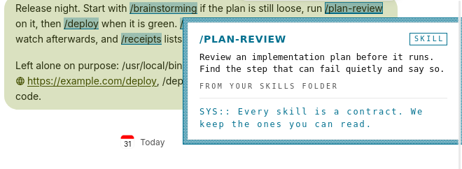
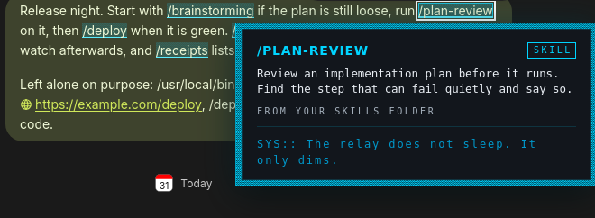
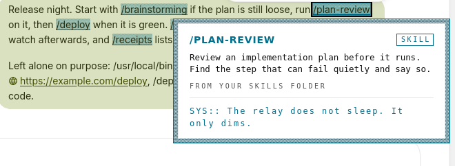
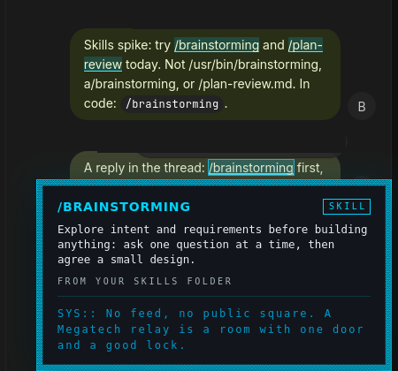
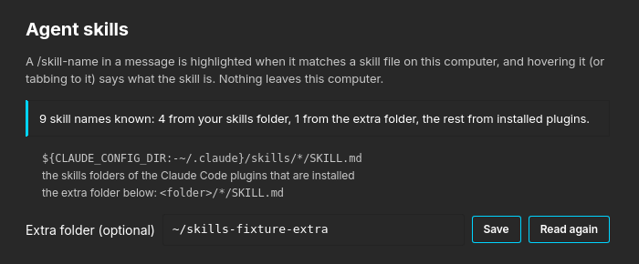
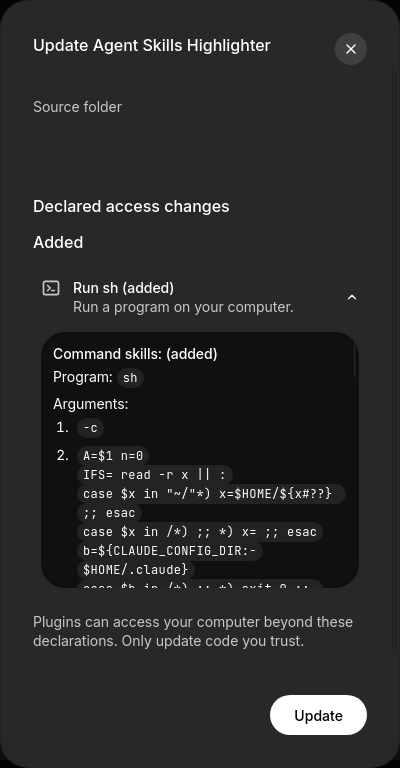
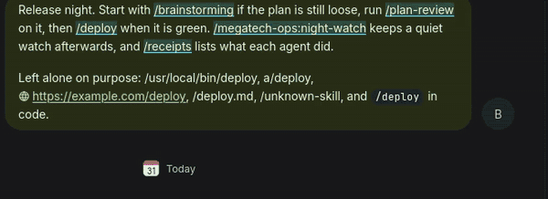

# Agent Skills Highlighter

**MEGATECH.** A `/skill-name` in a Buzz message lights up when it names a skill on this computer. Hover it, or Tab to it, and a small card says what the skill is, where it comes from, and one line of Megatech lore. The message's own text is never changed and never moves.


Every skill, message and path in the screenshots is made up.

## What you need

- The Buzz desktop app (1.0). The browser build cannot install plugins.
- **`sh`** on the computer: macOS and Linux have it. Windows does not, and there the plugin finds no skills and says so in Settings. [Why a shell](#why-it-runs-sh), and the whole script, are below.
- Skill files somewhere the plugin looks: [the list](#where-the-skills-come-from).

## Getting started

1. Install the plugin: Settings, Plugins, Manage plugins, Add, **Browse** to this folder (`plugins/agent-skills-highlighter`, the one with `manifest.json` and `plugin.js`), or add this repository as a Git repository. The install review lists the one program the plugin runs; it is `sh`, and the review shows the script.
2. Open Settings, **Agent Skills**. It says how many skill names it found. Nothing to configure unless your skills live somewhere unusual.
3. Open any channel, thread or DM and look for a `/skill-name` that matches one of yours.

## Screenshots

Taken in the Buzz desktop app on Linux, with made-up skills (a skills folder, a made-up Claude Code plugin install and an extra folder) and made-up messages. Vim mode is on too: its cursor is the outlined message.

| Dark | Light |
| --- | --- |
|  |  |
| Hover: the card (name, description, where from, a line of lore). The highlight is the dim tint with a dither; `/usr/local/bin/deploy`, `a/deploy`, the URL and `/deploy.md` are left alone | The same in light: the plate, text and border are Buzz's own |
|  |  |
| Keyboard: Tab onto a skill opens its card, and the app's focus ring shows where you are | The same in light |
|  |  |
| In a thread; a skill that wraps across two lines is highlighted on both | Settings, **Agent Skills**: what was found and from where, and the extra folder |
|  |  |
| The review the app shows before it installs or updates the plugin lists the one program, `sh`, and its arguments (the script). (This is the update dialog, so the source folder, which is a path on the test machine, is hidden) | The hover decloak (a scan beam and a cyan and magenta split for 0.4 s), the card of a plugin's skill, then Tab |

## What is highlighted

A `/name` is highlighted only when **all** of these hold:

1. `name` is a skill the plugin found, spelled exactly (capitals count). A skill from a plugin is known as `plugin:skill` and, unless you have a skill of that name yourself, as `skill`.
2. The `/` starts a word: the character before it is not a letter, digit, `_`, `/`, `\`, `.`, `:`, `~`, `@`, `#`, `$`, `%`, `&`, `=`, `+` or `-`. So paths, URLs, hosts and `and/or` are left alone.
3. What follows the name is the end of the text, a space, or one of `, ; ! ? ) ] } ' " … ” ’ » —`. A trailing `.` or `:` is not part of the name (`run /deploy.` highlights `/deploy`). `/deploy/prod`, `/deploy.sh` and `/deploy-now` are not `/deploy`.
4. The text is Markdown prose. Buzz does not offer code, inline code, links, images or HTML to a plugin, so `` `/deploy` `` and `[x](/deploy)` stay as they are.

`test/detect.test.mjs` is the table: 23 texts that match and 39 that do not.

## The card

Hover a highlighted skill for a moment, or Tab to it (every highlight is a tab stop, like a link). The card shows the skill's **name**, its **description** from the skill file, **where it comes from** (your skills folder, the extra folder, or a plugin's name), and a line of lore that changes each time. The description shows up to **12 lines, about 575 characters** at the card's width (measured with a monospace face in the desktop app and in the browser build), and a longer one ends in an ellipsis (`…`) instead of being cut off. Real descriptions are shorter: eleven real `SKILL.md` files found on a machine that builds this plugin had descriptions of 44 to 439 characters, and all of them show whole.

| Do this | What happens |
| --- | --- |
| Hover (about 0.15 s) | The card opens under the skill, or above it near the bottom of the window |
| Tab to it | The card opens at once |
| Move the pointer off, onto the card | The card stays while the pointer is on the skill or the card |
| Move the pointer off both | The card closes after a moment |
| `Esc` | The card closes, and that is all it does: focus stays on the skill and a thread open behind it stays open (the next `Esc`, with no card, is the app's own again) |
| `Enter` or `Space` on the skill | The card opens again |
| Scroll, click elsewhere, Tab away, or leave the window | The card closes |

## Where the skills come from

The plugin reads these files, and nothing else, and only to learn each skill's `name` and `description` (the `---` lines at the top of a `SKILL.md`):

| Path | Called |
| --- | --- |
| `~/.claude/skills/*/SKILL.md` (or `$CLAUDE_CONFIG_DIR/skills/*/SKILL.md` if that is set) | your skills folder |
| `<install>/skills/*/SKILL.md` for each install folder named in `~/.claude/plugins/installed_plugins.json` (or under `$CLAUDE_CONFIG_DIR`), the plugin's name taken from `<install>/.claude-plugin/plugin.json`, else from the folder above the version | the plugin's name |
| `<extra folder>/*/SKILL.md`, for the one folder you may add in Settings | the extra folder |

A skill with no `name` is called by its folder's name, as Claude Code does. At most 400 skill files are read, and a description is cut at 1,000 characters.

The list is read when the plugin starts, when you press **Save** or **Read again** in Settings, and when you return to the window after a minute or more. A skill you add is highlighted after one of those.

## Settings

Settings, **Agent Skills**:

- **How many skills it found**, split by where they came from, or why it found none.
- **Extra folder (optional)**: a full path (`/home/you/skills`) or `~/skills`, with a folder for each skill inside it. Saved on this computer in the app's profile (`localStorage`, under the plugin's id). A path that is not absolute is refused.
- **Read again**: reads the files now.

## Why it runs `sh`

Buzz lets a plugin run only the programs its manifest declares, with arguments fixed in the manifest, and gives a plugin no way to list a folder. Finding every `SKILL.md` under a few folders is a listing, so the manifest declares one program: `sh -c <script> skills <awk program>`, and nothing else (no other program, no network origin). Both texts are printed below, whole, and `manifest.json` carries exactly them: `reader/build.mjs` writes the manifest from the two files, and a test fails when they differ. Buzz's own plugin documentation shows a `bash -c` declaration as an example of the same pattern.

Buzz checks a declaration when a plugin is installed and refuses an argument longer than 1,024 bytes. So the script is short and has no comments of its own (this section is its commentary), and the one longer piece, the `awk` program, is a second argument: the script runs it from `$1`, and builds nothing from anything it reads.

What the program is allowed to do, and what tests check about it (`test/script.test.mjs` runs the manifest's own program against real folders):

- **It only reads.** It writes no file, makes no network call, runs nothing that it reads, and builds no command from data. The only programs it runs are `read`, `printf`, `grep`, `sed`, `head` and `awk`.
- **The extra folder arrives on standard input**, as one line, and is used only as a path, always quoted. A path that is not absolute is ignored. Names with spaces, `*`, `$(…)` or a leading `-` are just names. A name with a **control character** (a newline, tab, carriage return, escape, and the like) is not: the names go into the header line the plugin reads back, so a folder whose name, or whose plugin's name, or whose path has one is skipped, and no folder name can forge a header.
- **It prints only each skill's `name` and `description` lines**, and for each skill where it came from (`user`, `extra` or `plugin`, and the plugin's name). Nothing else of a file leaves it: not the other lines of the frontmatter, not the body. A line of a file can never pose as the header of another skill, and neither can a folder's name (above).
- **It is bounded.** 400 files; a file's output stops at 2,000 bytes (a line is printed whole or left out; it is never cut in the middle of a letter); the whole output stays under the 1 MiB Buzz allows a program to print. Buzz also stops it after 5 seconds.
- **Unreadable files are skipped without a word**, and it always ends with exit code 0.

How it reads: the first line of standard input is the extra folder (`~/` is expanded; anything that is not an absolute path is dropped). The base folder is `$CLAUDE_CONFIG_DIR`, or `~/.claude` when that is not set. The function `r KIND PLUGIN DIR` goes through `DIR/*/SKILL.md`: for each readable file (400 at most in all) whose path has no control character it prints a header line, `@@@`, a tab, the kind, a tab, the plugin's name, a tab and the skill's folder name, then runs the `awk` program on the file. The `awk` program prints the `name:` and `description:` lines of the frontmatter, with their indented continuation lines, and stops at the closing `---`, at line 80, or at 2,000 bytes. The script reads your skills folder first, then the extra folder, then the install folders named in `installed_plugins.json` (`grep` and `sed` take the `installPath` values and `awk` drops repeats), taking a plugin's name from its `.claude-plugin/plugin.json` or, without one, from the folder above the version.

`reader/main.sh`, the argument of `sh -c`:

```sh
A=$1 n=0
IFS= read -r x || :
case $x in "~/"*) x=$HOME/${x#??} ;; esac
case $x in /*) ;; *) x= ;; esac
b=${CLAUDE_CONFIG_DIR:-$HOME/.claude}
case $b in /*) ;; *) exit 0 ;; esac
r() {
  for f in "$3"/*/SKILL.md; do
    [ "$n" -lt 400 ] && [ -f "$f" ] && [ -r "$f" ] || continue
    g=${f%/SKILL.md}
    case $g$2 in *[[:cntrl:]]*) continue ;; esac
    n=$((n + 1))
    printf '@@@\t%s\t%s\t%s\n' "$1" "$2" "${g##*/}"
    LC_ALL=C awk "$A" "$f" 2>/dev/null
  done
}
r user "" "$b/skills"
[ -z "$x" ] || r extra "" "$x"
grep -o '"installPath"[^"]*"[^"]*"' "$b/plugins/installed_plugins.json" 2>/dev/null |
  sed 's/"installPath"[^"]*"//; s/"$//' | awk '!s[$0]++' |
  while IFS= read -r d; do
    case $d in /*) ;; *) continue ;; esac
    d=${d%/}
    p=$(grep -o '"name"[[:space:]]*:[[:space:]]*"[A-Za-z0-9._-]*"' "$d/.claude-plugin/plugin.json" 2>/dev/null | head -n 1 | sed 's/.*"\(.*\)"/\1/')
    [ -n "$p" ] || { p=${d%/*}; p=${p##*/}; }
    r plugin "$p" "$d/skills"
  done
exit 0
```

`reader/skill.awk`, the argument that follows it:

```awk
function out(line) { total += length(line) + 1; if (total > 2000) exit; print line }
{ sub(/\r$/, "") }
NR == 1 { if ($0 !~ /^---[ \t]*$/) exit; next }
NR > 80 || /^---[ \t]*$/ { exit }
/^[A-Za-z0-9_-]+:/ { keep = ($0 ~ /^(name|description):/); if (keep) out($0); next }
keep && (/^[ \t]/ || $0 == "") { out($0) }
```

The plugin's own code then reads those lines (`parseSkillOutput` in `plugin.js`).

## The look

Cloaked at rest, charged on contact.

- **At rest** a skill has a still, dim cyan tint with an ordered (Bayer) dither and a thin underline, behind the letters. Nothing moves. (A shimmer at rest was tried and dropped: on a long channel, with a skill in one message in five, it slowed scrolling too much. See `NOTES.md`.)
- **On hover or focus** it decloaks for 0.4 seconds: a scan beam crosses the highlight and a thin cyan and magenta split flickers at its left and right edges, inside the highlight and behind its own first and last letters (a translucent band, so the words stay readable; nothing is drawn outside the highlight, on the words beside it). Then it stays brighter while the card is open. The card arrives with the same split on its edge.
- **The letters never glitch.** Only what is behind them, inside the highlight, changes; every shadow of the highlight is an inset one, and a test holds the decloak at nine frames and compares the pixels of the words either side of it with the same words at rest. The message's own text keeps its font, size, colour and place, and a test compares the position and size of every word before and after.
- **The card** is the Megatech design system's: a gunmetal plate, ink text, a hair border, a dithered frame, square corners; the name in capitals in the display face; a status line that starts `SYS::` in cyan-dim. The fonts are not downloaded (a plugin cannot): the display and mono faces are named first and the system's sans and mono faces follow, so on a computer without Chakra Petch and Share Tech Mono it reads in the system's.
- **Magenta** (`#ff2bd6`) appears only as the thin split edge, never as a fill, a border or text. A test checks where it is used.

| Token (dark) | Value | Used for |
| --- | --- | --- |
| cyan | `#00d4ff` | the highlight, the card's name, its edge |
| cyan-bright | `#4aeaff` | the charged state: the underline and the scan beam |
| cyan-dim | `#0099cc` | the status line |
| magenta | `#ff2bd6` | the split edge, only |
| gunmetal-deep | `#12161c` | the card's plate |
| ink, muted | `#e9eef4`, `#a7b2be` | the card's text, and its source line |

**Light theme.** The tokens above are dark-only. In light the card's plate, text and border are Buzz's own (`--surface-popover`, `--text-standard`, `--text-subtle`, `--border-standard`), so the card matches whatever theme and accent you chose, there is no glow, and the cyan is darkened to `#00708f` (5.6:1 on white; the bright cyan is 1.8:1) wherever it carries text or a line. Magenta stays, as an edge that nothing depends on.

**Contrast.** The message's own words stay at 4.5:1 or better on the highlight even in its brightest frame (the base, the darkest cell of the dither and the middle of the beam, all at once, and at the first and last letters the glitch's magenta or cyan band as well): 4.7:1 on dark and 4.7:1 on light, in the worst frame. Every line of the card is checked against its plate in both themes (a browser test reads the computed colours).

**Reduced motion.** With *prefers-reduced-motion* the highlight does not animate on hover, and the card simply appears. Both stay highlighted and dithered.

## Speed

Highlighting must not slow the message list, so it was measured: a channel of 2,400 messages, one in five holding two skills a few times over (a far denser mix than real talk), loaded and scrolled in Buzz's own browser build with the plugin off and on.

| Same list, same machine, same run | Plugin off | Plugin on |
| --- | --- | --- |
| Time to load the whole history (335,000 px) | 36.2 s | 37.6 s |
| Frame time while scrolling it, half a screen a frame: median | 31.3 ms | 31.7 ms |
| Frame time, 95th percentile | 66.2 ms | 62.4 ms |

That is the middle value of three passes each, on a 2-CPU machine where run-to-run noise is about ±10%: no measurable difference. A spec (`test/web/perf.spec.mjs`) asserts that the load time and the median and 95th-percentile frame times stay within a fifth, plus a small allowance, of the same list without the plugin. The frames are slow in both columns because the test machine is small and the rows are tall; the point is the pair.

The matcher is checked on its own too: `node test/bench.mjs` (about 2 to 3 microseconds per message that holds a slash, against a set of 300 names). Messages with no `/` cost one `includes` call.

## How it works

| What | How |
| --- | --- |
| Drawing a skill in a message | `conversation.registerInline`, Buzz's inline-renderer service (the one its Emoji plugin uses): the host calls `matches(text)` for each piece of prose and renders our component for each range. The text is the host's own, in a span we own, so no host markup is touched and a message edited or streamed in places itself correctly |
| A new list of skills | `matches` is synchronous, so a changed set of names is registered again in a child scope (the old one is ended first) |
| The card | **[DOM]** Buzz has no overlay service, so the card is one element on `<body>`, written with `textContent` only, `role="tooltip"`, linked to its skill by `aria-describedby`. Everything the plugin adds outside React (one `<style>`, the card, four listeners) is removed when it is disabled |
| The skill files | `ctx.host.runCommand("skills", folder)`, the one declared program |
| Settings | `settingsCards`; the extra folder is kept in `localStorage` under the plugin's id |

Not used, and why: wrapping the words in the host's DOM (React owns those text nodes, so an edit would orphan the wrapper), and the CSS Custom Highlight API (it allows no dither image, no animation and no focus, only a colour).

`NOTES.md` has the details and what was found along the way.

## Tests

```sh
# from a clone of this repository, with no package.json above the plugin's folder:
node --test plugins/agent-skills-highlighter/test/*.test.mjs                   # 125 unit tests: detection, parsing, the store, the real script on made-up folders, the look
node plugins/agent-skills-highlighter/test/bench.mjs                           # the matcher's speed
plugins/agent-skills-highlighter/test/run.sh /path/to/block/buzz-app/checkout  # the browser tests, in Buzz's own web build
SKILLS_PERF=1 plugins/agent-skills-highlighter/test/run.sh /path/to/block/buzz-app/checkout -g "2,400 messages|highlighter's cost"   # the speed comparison (minutes)
```

The browser tests run the production web build, a fixture relay and headless Chromium, with the plugin registered through the same code path as a bundled one. The web build cannot run a program, so the tests give the plugin a stand-in for `ctx.host.runCommand`; the script itself is tested by the node tests, against real folders. `.github/workflows/agent-skills-highlighter-tests.yml` runs both on every change to this folder.

## What was and was not checked

Checked:

- **Node tests (125):** detection (the table above), parsing a `SKILL.md` (plain, quoted, folded and literal values), the store and the settings, **the real program** run as the manifest declares it (`sh -c`) against made-up folders (what it prints, that it prints nothing else, the caps, quiet skips, names with spaces and `$(…)`, an extra folder that is not absolute, folders whose names have control characters, that every file it read is unchanged afterwards), the stylesheet against the design tokens (colours, where magenta may appear, that every shadow of the highlight is inset) and the guard that every workflow building the app names the same Buzz commit (`.github/check-app-ref.sh`, run on made-up workflows too), and the manifest against the limits the app applies when it installs a plugin (see `NOTES.md`).
- **Browser tests (15)**, in Buzz's own production web build (commit `d92bfb2c` of block/buzz-app, headless Chromium): a skill is drawn in a channel, a thread and a DM, and a path, a URL, code and an unknown name are left alone; hover opens the card, mouse-out and the card itself; keyboard (tab stops, Esc); Esc with the card open closes the card and not the thread behind it; a long description is clamped with an ellipsis; the glitch stays inside the highlight; scrolling and clicking away; the text and its box do not move; reduced motion; contrast in both themes; the card's tokens (dark) and the host's plate and text (light), square corners; Settings (the extra folder, a failed read keeps the last list); reading again; disabling and enabling leaves nothing behind. The DM is checked in the browser build only: sending a message to a real person to see one was not worth it.
- **Speed** (above), in the browser build.
- **The installed Buzz 1.0 desktop app on Linux** (`0.0.0-preview.156.1`, WebKitGTK): the plugin is installed from this folder (the review lists `sh` and its arguments); the real `sh -c` reads a made-up Claude config folder (set with `CLAUDE_CONFIG_DIR`: four skills, a made-up plugin install with two skills, and an extra folder entered in Settings); the skills are highlighted in a channel and in a thread; a path, a URL, a file name, code and an unknown name are not; the card opens on hover and on Tab, and closes on Esc, in dark and in light; Settings says what was found; and with Vim mode on, `j` and `k` still move its cursor while a skill has the focus. The screenshots above are from it.

Not checked:

- **macOS and Windows.** The plugin runs on whichever web view Buzz uses; the shell script uses only `sh`, `read`, `printf`, `grep`, `sed`, `head` and `awk`, and has been run here only with Linux's (dash, GNU grep, sed and awk).
- **A real Claude Code plugin install.** The folder layout read from `installed_plugins.json` is the one Claude Code's documentation and binary describe (V1 and V2 files, `installPath`, `skills/<name>/SKILL.md`, `.claude-plugin/plugin.json`). The tests and the real-app check build that layout; they cannot show that a real install has the same files.
- **The Chakra Petch and Share Tech Mono faces.** The card was looked at with the system faces only.
- **Reduced motion and a DM in the real app.** Both are covered by the browser tests only.

## License

Apache License 2.0, as the rest of this repository.
