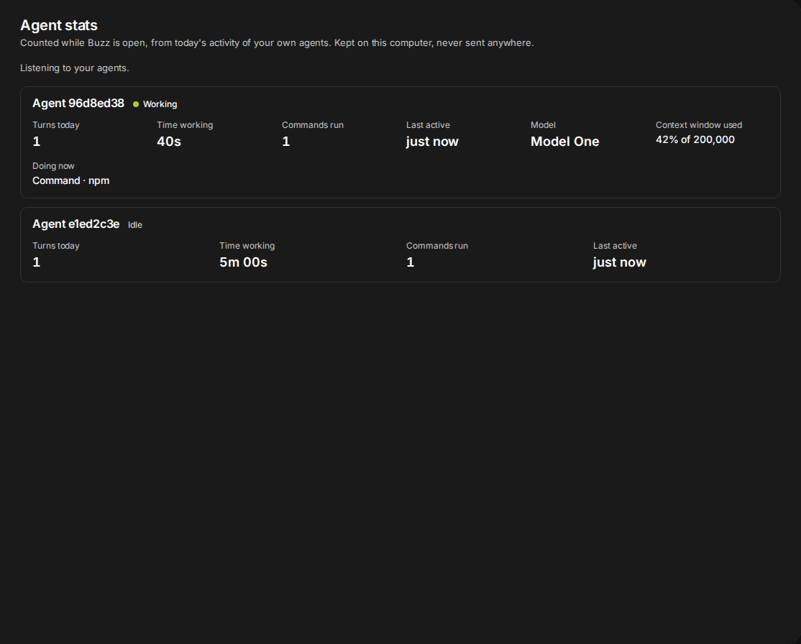
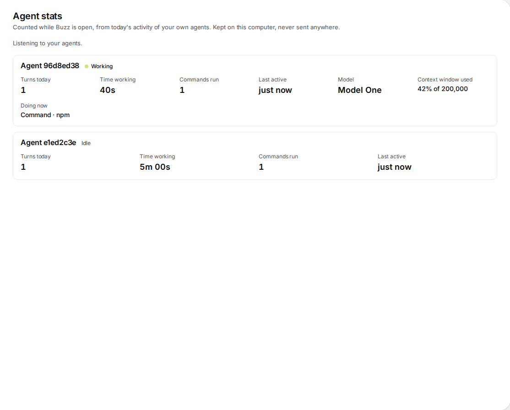

# Agent Stats

> [!NOTE]
> 🍳 **Cooking.** This plugin is a work in progress: it runs and is tested in Buzz's web build, and it has not been run in the desktop app yet. It will still change.

## What it is

Click one of your agents in Buzz and see what it did today: how many **turns** it took, how long it spent **working**, how many **commands** it ran, when it was **last active**, and what it is **doing now**. When the agent reports them, it also shows its **model** and how full its **context window** is.

The numbers are added up from the live telemetry Buzz already receives from the agents you own. They are shown in two places:

- a **Stats** tab in the agent's profile (the panel that opens when you click an agent), after Activity;
- a page, **Agent stats**, with one card for every agent that has reported, the busy ones first. Buzz gives a profile tab only to agents it runs or hosts; an agent running on another of your devices has none, and the page is where you find it.





The agents, keys and numbers in the screenshots are made up.

## What you need

- The Buzz desktop app, in a build whose plugin API has `ctx.agents.registerTab` (block/buzz-app has had it since commit `a65463acb`). On an older build the page still works and the tab is left out.
- A build that shares the agent telemetry with plugins (see [How it works](#how-it-works)). If yours does not, the page says so and shows nothing.
- Agents of your own that run under Buzz's agent bridge. Other people's agents are never shown: Buzz only receives the telemetry of the agents you own.

## Getting started

1. Install the plugin: Settings, Plugins, Manage plugins, Add, then **Browse** to this folder (`plugins/agent-stats`, the one with `manifest.json` and `plugin.js`), or add this repository as a Git repository. The plugin asks for no program, no network address and no file.
2. Open the **Agent stats** page from the Messages sidebar, or search for it.
3. Let your agents work. Their cards appear as soon as they report.

## What the numbers mean

| | |
| --- | --- |
| **Turns today** | The turns that began today, by your computer's clock. A turn that began before midnight counts on the day it began. |
| **Time working** | From the start of each turn to its end. A turn that is running now counts up to this moment. A turn that stopped reporting without an end counts up to its last report. Turns of one agent that overlap (two channels at once) count once, so the total never passes the clock. |
| **Commands run** | The tool calls that ran a command, each counted once: those the agent marks as ACP kind `execute`, and Buzz's own shell tool, recognised by its exact name `buzz-dev-mcp__shell`. A tool with a similar name is not counted. |
| **Last active** | The last time anything was heard from the agent, on any day. |
| **Doing now** | The agent's latest tool call. For a command it shows only the program that runs (`Command · npm`), never the arguments, which can carry a token. When it cannot tell the program for certain (a setting with a quoted or substituted value before it, a program in quotes, a first word that is an option) it shows just `Command`. For a file tool it shows the file's name. Shown only while a turn is running, and never saved. |
| **Model** | The model the agent reports in its session settings, as it names it. Shown only when it reports one. |
| **Context window used** | How full the agent's context window is, as the agent reports it. This is the window, not the tokens spent. |

### Today means "seen today, while Buzz was open"

The telemetry is live only. The relay does not keep it and Buzz does not save it, so the plugin can only count what Buzz saw while it was running. If Buzz was closed for the morning, the morning is not in today's numbers. The page says so. The day's tally is kept on this computer, so closing and reopening Buzz does not lose it, and it is kept for the day and the day before, so a turn that crosses midnight is counted once.

## Tokens and cost are not shown

Agents also publish a stored, per-turn **metrics** event with the model, the tokens and the estimated cost. A plugin cannot read it. Buzz never subscribes to it, it is encrypted to you, and the plugin API has no way to decrypt. The plugin does not go around that. If Buzz ever hands plugins the metrics, tokens and cost belong here; [NOTES.md](NOTES.md) says what is known.

## How it works

A plugin that asks for the `relay` service gets Buzz's session, and the session holds the agent telemetry, already decrypted by Buzz itself (the plugin never sees a key). Taking its lease is what makes Buzz listen for it. Block documents this surface only for its own Agent Activity plugin, so Agent Stats checks that it is there and says so when it is not. It does not rely on Agent Activity being on: it takes its own lease, and gives it back when you turn the plugin off.

The plugin publishes nothing and makes no request. It keeps one entry per community in the app's `localStorage`, under the plugin's id and the community's scope: the agents' public keys, turn and tool-call ids, times, and the model's label. It does not keep what a command was, a message, or an agent's name. The one thing it adds to the page outside its own panels is a `<style>` element, and it removes it when you turn the plugin off. Colours and type come from the host's theme.

## Platforms

| macOS | Linux | Windows |
| --- | --- | --- |
| should work, untested | should work, untested | should work, untested |

The plugin has run only in Buzz's own web build, in headless Chromium on Linux, and against a made-up Buzz. It uses nothing that is specific to an operating system. [What was and was not checked](NOTES.md#what-was-and-was-not-checked).

## Tests

```
node --test plugins/agent-stats/test/*.test.mjs                     # the unit tests, no install
plugins/agent-stats/test/run.sh /path/to/block/buzz-app/checkout     # the browser tests
```

The browser tests need the checkout installed (`pnpm install --frozen-lockfile`, `pnpm exec playwright install chromium`) and at the commit named in `.github/workflows/agent-stats-tests.yml`. Set `SHOTS` to a folder to have them write the two screenshots.
