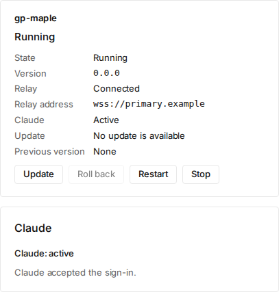
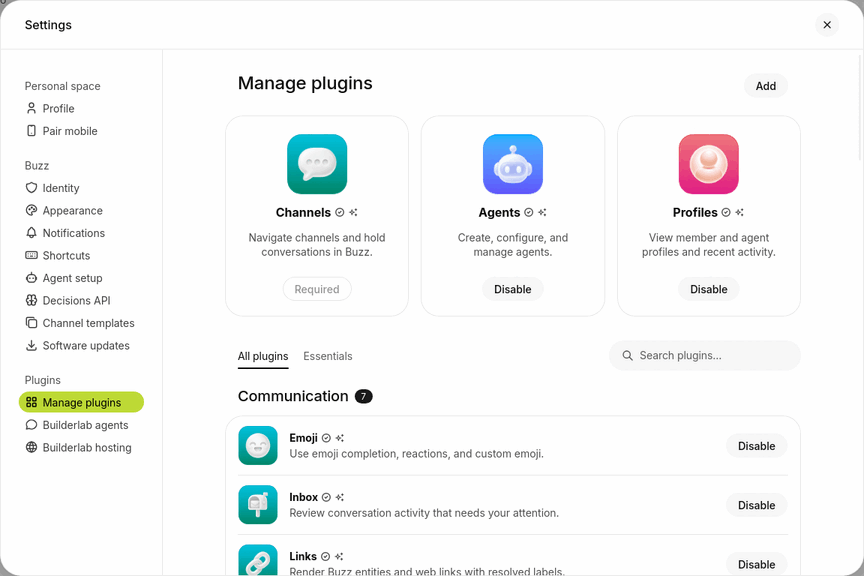
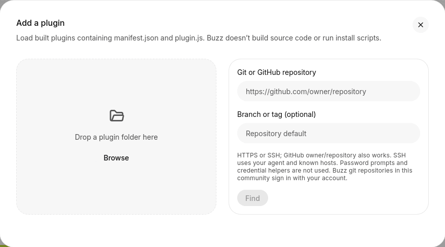
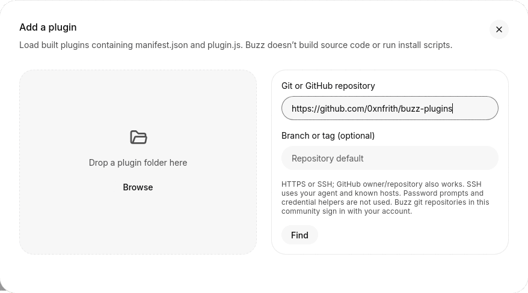
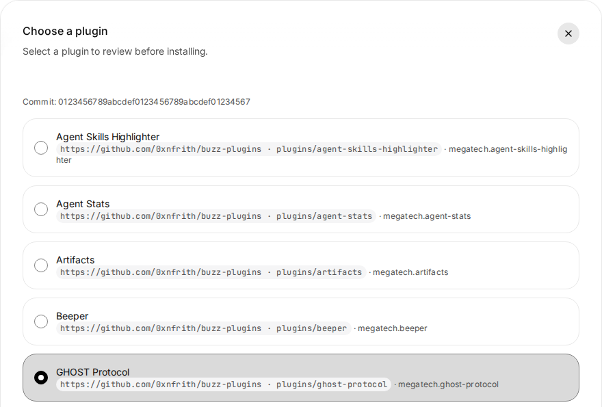
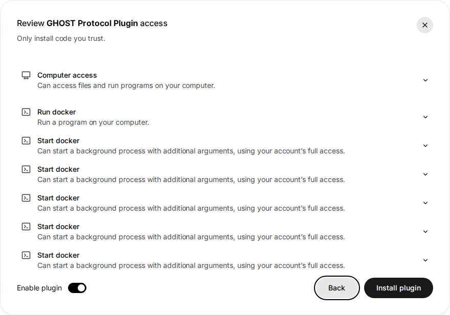
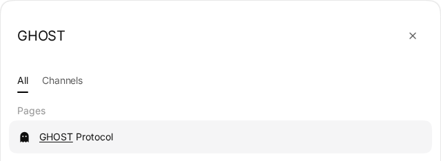
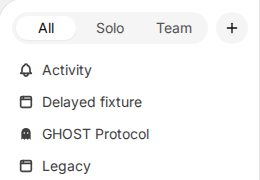
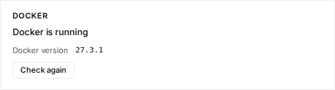
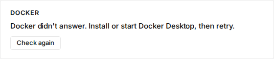

# GHOST Protocol

The Buzz side of GHOST Protocol: screens for an agent that runs in Docker on your own computer. It holds no agent key, stores no Claude token and has no agent logic; all of that stays in GHOST Protocol itself, which the plugin drives only through the `docker` command.

**This version has three parts.** A check of Docker; a **status screen** for one agent (what GHOST Protocol says about itself, and four buttons); and an agent type, **GHOST Protocol**, in **Agents → New agent → Create a new agent**, which makes the agent in Docker on your computer and adds a **GHOST Protocol** tab to the panel of agents of that type. The image GHOST Protocol ships is not released yet, so Create stops at the download until it is (see *What was and was not checked*).

## What it does

- A page, **GHOST Protocol**, with a ghost icon (where to find it: see [Where the page is](#where-the-page-is)). It has a **Docker** panel: it runs `docker version --format {{.Server.Version}}` and shows **Docker is running** with the server's version, or **Docker didn't answer. Install or start Docker Desktop, then retry.** It says the same for every way the check can fail: no `docker` on the computer's PATH, Docker not running, no answer within the 5 seconds Buzz gives the command, a non-zero exit, or an exit 0 with something that is not a version. Buzz's `runCommand` gives the plugin only "it failed", and not why, so the page cannot say which. **Check again** runs it again.
- An **Agent** panel with one field, **Agent name in Docker**, and **Show status**. The name is the agent's `<slug>`: lower-case letters, digits and `-`, starting with a letter or a digit, up to 40 characters. The agent's container is `gp-<slug>`. Anything else is refused before any command is built.
- The **status screen** for that agent, which asks `docker exec gp-<slug> gp status --json` at once and again about every ten seconds, for as long as it is on the page (leaving the page stops it, and any command it was running). It shows:
  - the **state**: *Waiting for a Claude sign-in* (`needs-claude`), *Waiting for the owner's attestation* (`needs-auth-tag`), *Connecting to the relay* (`connecting`), *Running*, *Updating* or *Error*, and for an error its code and message;
  - the **version**, the **relay** address and what the relay said (*Connected*, *Refused: not a member*, *Cannot be reached*), whether **Claude** is *Active* or *Not active*, whether an **update** is available and to which version, and the **previous version** to go back to;
  - when the relay refuses the agent (`refused-not-member`): GHOST Protocol's text for it, "Your relay does not accept owner attestations. Ask its admin to turn them on, or to add this agent as a relay member.", with the agent's public key and a **Copy** button;
  - when `interface` is a number the plugin does not know: only "Update this plugin, or update GHOST Protocol", with no buttons. It keeps looking, so it recovers by itself once GHOST Protocol or the plugin is updated.
- When `docker exec` fails, `docker inspect --format {{.State.Status}} gp-<slug>` says why: the container is **stopped** (with **Restart**), there is **no such container**, the container runs but GHOST Protocol **did not answer**, or Docker itself is not there. When the last status said `updating`, or an **Update** or **Roll back** was taken from this screen and no status with another version has arrived since, a container that is missing, stopped, or running without an answer is shown as still updating, for up to two minutes from the first look that found it so; after that the screen shows what it found. An update swaps the container, and for a few seconds it is not there; a swap can be quicker than the ten seconds between two looks, which is why a request counts as well as a status. A request that is over without a new version (the update was seen, and the agent is back on the old version) stops counting, and so does one that a **Stop** or **Restart** from this screen has ended: the next look says what it finds, so a container you stopped is shown as stopped, with **Restart**, and not as being swapped.
- Four buttons, each one `docker` call:
  - **Update**: `gp update request`. The agent finishes its task first, then updates. When there is nothing to take, or an update is already under way, the screen says so. When the agent has no update helper (`no-updater`), the button gives way to the three steps to update by hand, each in its own copy box, with the image's name from the container and the new version filled in. The image is pinned by digest, but GHOST Protocol's answer to an update names only the new version, so the steps show its digest as `<digest of that version>`, and a note above them says to fill it in and to run step 2 (which removes the container) only once step 1 has pulled the image. Those steps are provisional: GHOST Protocol's side fixes their final text, and they are one constant in `src/update-by-hand.ts`.
  - **Roll back**: `gp update rollback`, disabled while there is no previous version.
  - **Restart**: `docker restart gp-<slug>`. **Stop**: `docker stop gp-<slug>`.
- It needs Docker (Docker Desktop on macOS and Windows) with `docker` on the PATH that Buzz gives a plugin's programs, and an agent whose container GHOST Protocol started. It does not start Docker or install anything. The page and the status screen create, start and remove nothing; the agent type's **Create** and Buzz's **Delete** make and remove an agent, its helper and its data (below).

## The create form and the agent's tab

In **Agents → Create agent**, **GHOST Protocol** is a Remote agent type (Buzz holds no key and runs nothing; the agent's key is made inside its own Docker volume). Choosing it adds three things to the dialog, under Buzz's own Harness row, name and avatar:

- **Where it runs**: **This computer**, or **Hosted**, which is disabled and says *coming soon*. Hosted makes no call.
- **Your Claude account**: a status line and a way to connect. Paste a setup token (made with `claude setup-token`), or sign in at an address. The agent's tab has the full guide (below). The token is held in memory until the one command that takes it has run. It is never written to the agent's saved settings, to storage or to a log, and it goes to the agent on stdin, never as a command argument.
- **Let GHOST Protocol update itself? It needs control of Docker to swap in new versions. You can say no and update by hand.** Yes or no, with no answer chosen for you; Create waits for one. A yes starts a second small container beside the agent, the update helper, which has the Docker socket; a no starts none.

**Create** then runs these steps, and shows each as it happens:

| Step | Command | If it fails |
| --- | --- | --- |
| 1. Check Docker | `docker version` | *Install or start Docker Desktop* |
| 2. Download | `docker pull` of the one image | Docker's own reason, in one line |
| 3. Make the key | `docker run --rm … init`, with the agent's name, your community and your public key | GHOST Protocol's reason; a container of that name already on this computer is left alone |
| 4. Start the agent | `docker run -d … gp-<name>` | Docker's reason |
| 5. Start the helper, after a yes | `docker run -d … gp-<name>.updater` | Docker's reason |
| 6. Give it your attestation | `gp auth-tag set`, with the tag Buzz signed on stdin | *did not accept your attestation* |
| 7. Sign in to Claude | `gp claude token` or `gp claude login`, on stdin | the sign-in is refused |
| 8. Wait | `gp status --json` until `running` | the relay refuses it (*Your relay does not accept owner attestations…*, with the agent's public key), reports an error, or does not answer in two minutes |

Every step looks before it acts, so pressing Create again after a failure carries on and never starts a second container.

**What Buzz does while Create runs, and what that means here.** Buzz's dialog replaces the type's form with its own "Meet your remote agent" step and a spinner for as long as Create works, so the type cannot draw live progress, an address or a field then. So: a failure says which step stopped and why in one line (Buzz shows it), and **Back** shows the form with the steps and what each came to, and for a refused relay the agent's public key with a **Copy** button (the message carries the key too). The sign-in by **address** needs a person to act while it runs, so it is not part of Create: with that way chosen, Create stops where the agent waits at *Waiting for a Claude sign-in*, and the agent's **GHOST Protocol** tab does the sign-in (see below). The sign-in by **setup token** has everything it needs before Create starts and runs inside it. When Create runs again with no token held (Buzz's **Finish setup**, or after Buzz was restarted, which run the steps again with the saved settings and no form), the agent is not refused: it is left waiting for Claude, and its tab does the sign-in. Which way the form leads with is one constant, `CLAUDE_LEADS` in `src/gp/constants.ts`; the token's way leads until the address's is proven.

**The agent's tab.** Every agent of this type has a **GHOST Protocol** tab in its panel, and no other agent has one. It holds the status screen described above (for that agent, with no name to type) and the agent's **Claude** section. The plugin finds the agent's container by the name it was made with, which it writes down in this computer's browser storage when it makes the agent (the pair of public key and container name; nothing secret). **The tab acts only on a container that is this agent's.** It first asks the container's own status (`gp status --json`) for its public key: when that is not this agent's key, the tab says *This container belongs to another agent* and shows no buttons and no token field. If that storage is cleared the tab falls back to the agent's current name, and then acts on `gp-<name>` only when the container's status names this agent's key (a container that is stopped, missing or silent cannot say, and the tab says it does not act on it); and **removing** the agent in Buzz then touches no container: it stays in Docker, in plain sight, for you to remove with `docker rm -f`.

**The Claude section, and its guide.** It says **Claude: active** or **Claude: not active**, from `gp claude status`. It looks when the tab opens, again about every ten seconds while the tab is open (so a sign-in made from a terminal shows up without a press), and right after a sign-in, when the status screen above it looks again at once too (its Claude row says *Active* or *Not active* in the same words). Leaving the tab ends the looks and any sign-in under way. **Check again** looks now. While a sign-in is under way the repeated looks wait.

When the agent is not active, the section shows a guide for someone who has never done this, in plain short steps with every command in a copy block (a **Copy** button that puts exactly that command on the clipboard):

- what a Claude subscription is and that the agent needs one: Pro, Max, Ultra, Team or Enterprise, and not the free plan, which does not include Claude Code (a link to the plans);
- **Option 1 (recommended): paste a setup token.** Open a terminal on your own computer, check `claude --version`, and if it is not there install Claude Code (`curl -fsSL https://claude.ai/install.sh | bash` on macOS, Linux or WSL; `irm https://claude.ai/install.ps1 | iex` in Windows PowerShell; a link to the installation help). Then run `claude setup-token`, which opens the browser to sign in and prints a long token, copy it, paste it into the field and press **Send token**;
- **Option 2: sign in at an address.** Press **Sign in with an address**, open the address it shows, sign in to Claude, and paste the code Claude shows into the box under the address (**Continue**, **Cancel**, **Copy address**);
- for each, what success looks like (the field or the box goes, and the section says *Claude: active*) and what a failure looks like: *Claude did not accept that token…* or *Claude did not accept the sign-in…* under the way that was tried, with GHOST Protocol's own code and one line beside it (`claude-token-invalid`, `claude-login-failed`). The commands and plans are the ones Claude Code's documentation gives (`code.claude.com/docs/en/setup`, `/authentication`).




**The token is never stored, logged or shown again.** It is held in memory for the one command that takes it and goes when that command ends, whatever it said: the field empties after a success and after a refusal, and when the tab is left. It goes to the agent on stdin, never as an argument, and GHOST Protocol's own words are cleaned of it (and of the login code) before they are shown, if they ever repeat it.

**Removing an agent** is Buzz's own **Delete agent**, which asks "Delete <name>?" and says that its provider deletes it and its key and that it can't be undone. When you press **Delete**, this plugin stops the agent's container and its update helper and deletes its **data volume** (`docker rm -f gp-<name> gp-<name>.updater`, then `docker volume rm gp-<name>-data`). **That volume holds the agent's key and also its memory, so Delete removes the memory too, for good, though Buzz's text names only the key.** Keeping the volume would leave a key that Buzz has already said it deleted, so it is not kept. To keep a copy of the memory, **stop the agent first and then copy the volume, both before you press Delete**: a running agent keeps writing to its memory, and a copy taken while it does can be torn and fail to restore. For example, into a file in the current folder:

```text
docker stop gp-<name>
docker run --rm -v gp-<name>-data:/from -v "$PWD":/to alpine tar czf /to/gp-<name>-data.tgz -C /from .
```

One already gone counts as removed. If Docker is not running when you press Delete, the plugin cannot remove the container, Buzz says the agent could not be removed and to delete it again, and Delete again removes it once Docker is back.

**The profile comes from the agent.** GHOST Protocol's interface has no command that publishes a name or a picture; the agent publishes its own profile, signed with its own key, when it first starts, and the name from the form reaches it through `init --name`. So this type does nothing for Buzz's "publish the profile" step.

An interface number the plugin does not know stops Create with *Update this plugin, or update GHOST Protocol*.

## What it asks for

The install review shows what a plugin asks of your computer. For this one it must show exactly these twelve, and nothing else: one command, and eleven processes. Each is the program `docker` with its first words fixed, so the plugin can start `docker` for these verbs and no other:

| Entry | Starts | What follows, which the plugin gives |
| --- | --- | --- |
| Command `version` | `docker version --format {{.Server.Version}}` | nothing: every word is fixed, it takes no input, and Buzz gives it 5 seconds and 4096 bytes of output |
| Process `pull` | `docker pull registry.invalid/ghost-protocol:0.0.0@sha256:0000000000000000000000000000000000000000000000000000000000000000` (the one image, pinned by tag and digest: a tag can be moved after it was tested, a digest cannot. **This value is a placeholder**, version `0.0.0` and a digest of zeros on `.invalid`, which can never resolve, until GHOST Protocol sends the real one) | nothing: every word is fixed, the image included |
| Process `run-init` | `docker run --rm -v` | the data volume's name and `:/data`, the image, and `init --name <name> --relay <community> --owner <your public key>` |
| Process `run-agent` | `docker run -d --restart unless-stopped --name` | the agent's container name, its data volume, and the image |
| Process `run-updater` | `docker run -d --restart unless-stopped -v /var/run/docker.sock:/var/run/docker.sock --name` | the helper's container name, the image, the helper's command and `--target gp-<name>` |
| Process `exec` | `docker exec` | a container's name and the command to run in it |
| Process `inspect-state` | `docker inspect --format {{.State.Status}}` | a container's name |
| Process `inspect-image` | `docker inspect --format {{.Config.Image}}` | a container's name |
| Process `restart` | `docker restart` | a container's name |
| Process `stop` | `docker stop` | a container's name |
| Process `rm` | `docker rm -f` | the agent's container and its helper |
| Process `volume-rm` | `docker volume rm` | the agent's data volume |

For the command, Buzz's review says "Run docker", with its arguments, "Input: none" and the output limit: that is all it can do. For each process Buzz words it as *Process …: Start docker*, "Can start a background process with additional arguments, using your account's full access", and "Allows further arguments and standard input, with your account's full access". That is true, and this is how far it goes:

- **Known limit of Buzz: every declared process takes further arguments and standard input.** A process has only the fields `id`, `program`, `args`, `bundled` and `artifact`, and none of them can forbid more arguments or any input (`crates/plugin-manager/src/lib.rs`, `HostProcess`, in block/buzz-app at the commit the tests pin), so the review line above is the same for every process and cannot be removed. What the review can show is the fixed leading words, and that is what this plugin uses it for. A **command** is the closed kind: its arguments are all fixed and it takes input only if it declares so. It cannot take a container's name, so only `version`, which needs none, is one. The other eleven cannot be. What keeps the plugin to the words in the last column is its own code: every call is built in one place, from a fixed list, and the unit tests hold the code, this table and the manifest equal.
- **`exec` is the wide one.** What follows `docker exec` is the container's name and the command, and both are the plugin's to give, so a plugin with this grant can run any command in any container on your computer, not only in a GHOST Protocol agent's. The plugin gives it `-i`, `gp-<name>` and a `gp` command, and writes the owner's attestation, a Claude setup token or a login code to it on stdin, which is the only reason any process of this plugin is given stdin. `restart`, `stop` and `rm -f` likewise take any container's name, and `volume rm` any volume's; this plugin only ever gives them `gp-<name>`, `gp-<name>.updater` and `gp-<name>-data`.
- **The three `run` entries can start a container with more than the words show.** What follows their fixed words is the plugin's, so a plugin with these grants could run another image, or mount a folder of yours. This plugin gives them its one image, `<registry>/ghost-protocol:<tag>@sha256:<64 hex>`, and the flags in the table above and nothing else. A bare tag, a bare digest, `latest` and a short or upper-case digest are not that image: the plugin then has no image, and Create stops at the pull. The one fact the review does show is which entry may mount **the Docker socket**: `run-updater` fixes it, ahead of the name, and no other entry names it. The socket gives whatever runs with it control of Docker on your computer, which is why the form asks the update question, and starts that helper only after a yes.
- **What the grant leaves out.** There is no entry for `cp`, `build`, `kill`, `create`, `start`, `push`, `login`, `system`, `network`, `compose`, `image` or any other verb. A later version that needs one declares its own entry, and the install review then shows it.
- **Nothing else is asked for:** no network address, no files, no other program. A Claude token or a login code you give goes to the agent on stdin and is not an argument, not stored and not logged.

The calls the plugin makes, which are the whole of what it does with these:

| When | `docker` is asked |
| --- | --- |
| The page opens, and **Check again** | the command `version`: `version --format {{.Server.Version}}` |
| Every ten seconds, while an agent's status is shown | `exec gp-<slug> gp status --json` |
| The status call fails | `inspect --format {{.State.Status}} gp-<slug>` |
| **Update** | `exec gp-<slug> gp update request`, and when the agent has no update helper, `inspect --format {{.Config.Image}} gp-<slug>` |
| **Roll back** | `exec gp-<slug> gp update rollback` |
| **Restart**, **Stop** | `restart gp-<slug>`, `stop gp-<slug>` |
| **Create**, steps 1 to 3 | the command `version`, `pull <image>`, `inspect --format {{.State.Status}} gp-<slug>` (to leave a container of that name alone), `run --rm -v gp-<slug>-data:/data <image> init --name <name> --relay <community> --owner <public key>` |
| **Create**, steps 4 to 8 | `inspect …` then `run -d --restart unless-stopped --name gp-<slug> -v gp-<slug>-data:/data <image>` (or `restart gp-<slug>` for a container that stopped); the same for `gp-<slug>.updater` after a yes, with the Docker socket mounted; `exec -i gp-<slug> gp auth-tag set` (the attestation Buzz signed, on stdin); `exec gp-<slug> gp claude status`, and for the token's way `exec -i gp-<slug> gp claude token` (on stdin); `exec gp-<slug> gp status --json` about every one and a half seconds until the agent runs, for two minutes at most |
| The agent's tab, Claude section | `exec gp-<slug> gp claude status` when it opens and about every ten seconds; sign-in by address `exec -i gp-<slug> gp claude login` (prints an address; the code goes on stdin); sign-in by token `exec -i gp-<slug> gp claude token` (on stdin) |
| **Removing** an agent | `rm -f gp-<slug> gp-<slug>.updater`, then `volume rm gp-<slug>-data` |

The only parts of any of them that the plugin does not fix are the agent's name, which it has checked first (see above), the community's address and your public key in `init`, and what goes on stdin; nothing GHOST Protocol or Docker prints becomes an argument. None of them runs a shell. Only three write to a process (`exec -i`): `gp auth-tag set` (the attestation Buzz signed, which is public), `gp claude token` (a Claude setup token) and `gp claude login` (the code from the sign-in address). None of the `run` calls does. The plugin never writes a file and never opens a network connection of its own. A Claude token is held in memory for the one command that takes it and then dropped: it is not stored, not logged and not an argument. The status screen and the page start nothing: **Update** only asks the agent. **Create**, from the agent type's form, does start containers (the agent, and its update helper after a yes) and removing the agent removes them. A declared program runs with your full access and is not sandboxed, as the review says. **If the review shows anything else, do not install it.**

## How to install

Copy and paste: in **Settings → Plugins → Manage plugins → Add**, put this in **Git or GitHub repository**, press **Find** and pick **GHOST Protocol**:

```text
https://github.com/0xnfrith/buzz-plugins
```

To install the last version that passed the checks instead, put its tag in **Branch or tag** first ([what a tag means](../../docs/known-good.md)):

```text
good/ghost-protocol
```

Then read the review (above), press **Install plugin**, and open the page (next). The desktop app is needed: the browser build cannot install plugins, or run a program.

The same steps, with the screens (the pictures are in the light theme; [how they were made](#the-pictures)):

**1. Open Settings, then Plugins, then Manage plugins, and press Add.**



**2. Choose how to load it.** The Add a plugin window has a folder on the left and a Git or GitHub repository on the right. Use the repository: there is nothing to download first.



**3. Type the address above and press Find** (it may read **Find plugins**). Leave **Branch or tag** empty, or fill it with the tag above.



**4. Pick GHOST Protocol and press Continue.** Buzz lists every plugin in the repository, with its folder and id.



**5. Read the review, then press Install plugin.** Beside the **Computer access** row that every plugin gets, it must show one **Run docker** and eleven **Start docker**, twelve rows in all, and nothing else (see [What it asks for](#what-it-asks-for)). The list scrolls: the picture is its top, and the rows below the fold are the same **Start docker**. Each row opens to show its program and arguments. **Enable plugin** is on, so the plugin is turned on as it is installed.



## Where the page is

Installing adds a page, not a button in Settings: **Settings → Plugins → Manage plugins** lists the plugin and its state, and shows an error there if it did not start. Open the page in either of these ways:

- **Search:** press **Cmd+K** (Ctrl+K on Windows and Linux), or click **Search** at the top of the window, type `GHOST`, and choose **GHOST Protocol** under **Pages**. This always works, whichever part of Buzz is open.
- **The Messages sidebar:** pick **Messages** (the first icon in the left rail). In its sidebar, under the **All / Solo / Team** tabs, the pages are listed below **Activity**: **GHOST Protocol**, with a ghost icon. If the sidebar is hidden, the button at the top left of the window shows it, and in a narrow window it is behind **Show navigation**.





If it is in neither place, the plugin did not start: look at **Settings → Plugins → Manage plugins** for its error.

## What the page shows first

The **Docker** panel. With Docker running it says **Docker is running** and the version of Docker's server:



When Docker does not answer it says so, for every way the check can fail (see [What it does](#what-it-does)):



Start Docker Desktop, then press **Check again**.

## Check it on your computer

The plugin has not been run in the Buzz desktop app yet; a run on a real Mac is the check it is waiting for. If you try it, these are the steps, and what to write down:

1. Start Docker Desktop. Open **GHOST Protocol**: it should say **Docker is running** and show the version. Compare it with `docker version --format '{{.Server.Version}}'` in a terminal.
2. Quit Docker Desktop, press **Check again**: it should say **Docker didn't answer. Install or start Docker Desktop, then retry.** Start Docker Desktop again, press **Check again** until it shows the version.
3. If Docker Desktop is running and the page still says **Docker didn't answer**, write down `which docker` from a terminal and how you started Buzz: the plugin finds `docker` on the PATH Buzz gives it, and a Buzz started from the Dock may not have the one a terminal has.
4. With a GHOST Protocol agent running as `gp-<name>` (the image is not released yet, so for now one you started by hand), type `<name>` in **Agent name in Docker**, press **Show status**, and compare the screen with `docker exec gp-<name> gp status --json` in a terminal. Press **Restart**, then **Stop**, then **Restart** again, and watch the screen follow. Press **Copy** on a refused relay's key and paste it somewhere.
5. Open **Agents → New agent → Create a new agent**, choose **GHOST Protocol** as the Harness, and look at the form: **This computer** chosen, **Hosted** disabled with *coming soon*, the Claude choices, the question about updating itself, and **Create agent** held back until the question is answered and a token is pasted (or the address's way is chosen). Press **Create agent** with the image not released: it should stop at the download with *Docker could not download GHOST Protocol* and a reason from Docker. Quit Docker Desktop and try again: it should say *Install or start Docker Desktop*. Press **Back** and look at the steps.
6. When the image is released (the tag and digest in the `pull` entry of `manifest.json` are the only place to change), make an agent with a token and a yes, and watch the container and its helper appear in `docker ps`, the agent appear in the list, and its tab show *Running*. Then make one with the address's way, open its tab and sign in there; and make one with no sign-in, open its tab and follow the guide (install Claude Code if the check does not find it, `claude setup-token`, paste) from *Claude: not active* to *Claude: active*, then again with option 2. Try a wrong token and a wrong code and read what is said. Delete the agent in Buzz and check that `docker ps -a` and `docker volume ls` show nothing of it.
7. Write down the macOS version, the Buzz version, and a screenshot of the install review.

## What was and was not checked

| | |
| --- | --- |
| Unit tests (`test/unit`) | The manifest declares exactly the one command and eleven processes above, each `docker` with its fixed words, none for another verb, no flag that would widen a container in any `run` entry, and the Docker socket in one entry only; the image is named once, in the manifest, and the code reads it from there; it is pinned by tag and digest, and a bare tag, a bare digest, `latest` and a digest that is short, long, upper-case or not hex are refused, so that code run against a manifest that names one has no image and can make no command that names it, while another pinned image reaches the pull, the init, the agent's start and the helper's start unchanged; the command is closed (no input, no arguments of the caller's); every call the plugin builds names one of the processes and no declared process goes unused; Buzz's rules for a program and this repository's rules for a manifest pass. The check of Docker, with a stub standing in for the host's `runCommand`: a version shows on success, and the one failure text for null, a thrown call, an answer that is not a version and a host with no `runCommand`. The page's icon is one shape with a mask rule that matches only its own image. The status parser: every `state`, `relay` and `claude` value, an unknown interface, a status over several lines, and every field missing or of the wrong kind. Every call the plugin makes, to the letter, and that only a checked name goes into one. The look at an agent, **run against the fake `docker`** (below): every state, relay value and error, a stopped and a missing container, Docker down, and the two-minute gap while an update swaps the container (the minute before it, the moment it ends, and a gap that never does). The four buttons against the fake: each answer GHOST Protocol and Docker can give, and the steps to update by hand (the new version's tag, a placeholder for its digest, and none of the old digest). **The create flow, run against the fake**: every step, each failure at each step (Docker missing or down, a pull that fails, `init` that fails, a rejected attestation, a rejected token, a relay that refuses the agent, an agent that reports an error, an unknown interface number, an agent that never connects), a yes and a no to the update question, a repeat after a failure (nothing started twice, a stopped container started again), both docker wordings for a missing container, and that a Claude token or login code never reaches an argument, the fake's call log, the progress, a message or the stored settings. The sign-in by token and by address, a token left unheld (Finish setup), removal (the volume goes last, and not at all when the container could not be removed), the choice of the leading way following one constant, and the check that a container is this agent's. Every picture this README points at is a file, and `screenshots/` holds those pictures and no other (the repository's `plugin-assets` check reads every Markdown file's images the same way). Every picture this README points at is a file, and `screenshots/` holds those pictures and no other (the repository's `plugin-assets` check reads every Markdown file's images the same way). |
| The fake `docker` (`test/fake-docker`) | A fake `docker` written from GHOST Protocol's interface, which answers every command above and the failures around them, so none of this needs the GHOST Protocol image. It is for tests only; its README lists what it assumes where GHOST Protocol's interface is silent. The unit tests start it as a process and the plugin reads what it prints. |
| Browser suite (`test/web`) | The built plugin runs in Buzz's own production web build, in headless Chromium, at the commit `BUZZ_APP_REF` pins. The page is opened from the navigation, and its ghost icon is checked in navigation and in search, in light and dark, painted in the entry's own text colour. The status screen is drawn for every `state`, every `relay` value, an unknown interface, a stopped, a missing and an unreachable container, the update gap and its two-minute end, and each button's answers, with the page's clock moved by the test for the ten-second look. It asserts that the plugin asks the host for the declared command or process of each call's verb only, with the command lines in the table above, and that the fake never refused one. Light and dark text contrast. **The create form, in the same web build** (`test/web/create-form.spec.mjs`, with the fake's stdin and output streamed to and from the page): the type in the Harness list, the form and its held-back Create, Hosted disabled with no call, Create from the first press to an agent in the list with every command in order, a no to updates, a pasted token that is left nowhere (not a call, the page, a field or the browser's storage), Docker missing, a repeat after a failure, a refused relay with its public key and **Copy** button, an unknown interface, a Buzz that cannot start a program, the sign-in by address and by token from the agent's tab, Buzz's Finish setup with no token, the tab acting only on a container that names the agent's key, the tab on this type's agents only, Buzz's own Delete warning shown before anything is removed (and Cancel removing nothing), and the form in light and dark. It also makes the README's pictures (below) and checks that each is a small PNG and that `screenshots/` holds exactly those. It also makes the README's pictures (below), three of them of the Claude guide in the agent's tab, and checks that each is a small PNG and that `screenshots/` holds exactly those. |
| **Not covered** | **The real image.** GHOST Protocol's image is not released: the `pull` entry in `manifest.json` names a placeholder (version `0.0.0` and a digest of zeros on `.invalid`) that can never resolve, so a check of Create against the real thing has not been made. **Starting a process is desktop only, so the browser suite replaces the host's `spawn` and `runCommand` with stubs that run the fake `docker` in Node (or, for the Docker panel's own tests, scripted answers). Nothing in CI runs a real `docker`, a real GHOST Protocol, the plugin in the Buzz desktop app or the Git importer.** The whole of Buzz's **Delete** cannot be driven in the web build (Buzz archives the agent first, and the harness's fixture relay answers that with a 500), so removal is covered against the fake `docker` in the unit tests, and not through Buzz's own button. A run in the desktop app is not built yet. The clipboard is the browser's (`navigator.clipboard`, then the older copy command): whether the desktop app's webview on macOS allows it has not been tried. The pictures in this README are of Buzz's web build (and, for the first three install steps, of the desktop app), not of this plugin running in the desktop app. The pictures in this README are of Buzz's web build (and, for the first three install steps, of the desktop app), not of this plugin running in the desktop app. |
| Platforms | **macOS:** not run yet. **Linux:** should work, not run. **Windows:** not checked; whether Buzz can start `docker` there has not been tried. |

The pipeline, for a change to this folder: `.github/workflows/ghost-protocol-tests.yml` runs the type check, the unit tests, a check that the committed `plugin.js` is the build of `src/`, the tests of the fake `docker` (`test/fake-docker`) on Linux and on macOS through `test/fake-docker-tests.sh`, which fails when that folder has no test file or a test fails or is skipped, and the browser suite. `all-tests` waits for it.

## Tests

```sh
corepack pnpm@12.16.1 install --frozen-lockfile
corepack pnpm@12.16.1 exec tsc          # type check
corepack pnpm@12.16.1 test              # unit tests
corepack pnpm@12.16.1 run build         # writes plugin.js, which is committed
plugins/ghost-protocol/test/run.sh /path/to/block/buzz-app   # the browser suite; the app checkout needs its own install
plugins/ghost-protocol/test/screenshots.sh /path/to/block/buzz-app   # the README's pictures again, into screenshots/
```

`plugin.js` is committed beside `manifest.json`, because Buzz installs from a repository and never runs a build; CI fails a change whose `plugin.js` is not the build of its source.

## The pictures

The pictures are in `screenshots/`, in the light theme, and each is a small PNG. Steps 1 to 3 of the install are pictures of the Buzz desktop app that every plugin in this repository uses (`assets/install/`); they come from an older desktop build than the pinned web build, so a button may be worded a little differently (step 3's **Find** reads **Find plugins** in the pinned build). The others are made from Buzz's own production web build, at the commit `BUZZ_APP_REF` pins, in headless Chromium, with the app's own made-up community: none holds a real key, relay, person or path. `test/web/screenshots.spec.mjs` and `test/web/claude-guide-screenshots.spec.mjs` make them, and `test/run.sh` runs it in CI. A text that changed (the Docker panel's two messages, a row of the review, the dialogs' titles), a row of the review that is missing, or a picture that is missing, extra, not a PNG or not small fails the suite. A change of look (a layout, an icon, a colour) does not, and CI does not compare the committed files with what the spec makes, because fonts and anti-aliasing differ from one machine to the next. So whenever `BUZZ_APP_REF` moves, run `test/screenshots.sh` and read the pictures.

- **Choose a plugin and Review plugin access:** Buzz's own dialogs. The web build has no installer (it is desktop only, and shows no Add button), so the page says it is the desktop app and the installer's answer is scripted, the way Buzz's own tests do it: one row for each plugin folder of this repository, from its own `manifest.json`. Buzz draws the review from this plugin's real `manifest.json`; nothing of it is written in the test. The commit under the title is an example, not a real one. The picture of the list stops at this plugin's row.
- **Search and the Messages sidebar:** the built `plugin.js`, registered the way the web build registers an installed plugin. The other pages in the sidebar picture (Delayed fixture, Legacy) are the test build's own.
- **The Docker panel:** the built plugin, with what `docker version` prints scripted, because the web build cannot run a program: the version in the picture, 27.3.1, is the one the test says.
- **The Claude guide:** the built plugin in the agent's tab. An agent called Maple is made through the create form against the fake `docker` (`test/fake-docker`) with its Claude sign-in left for later; the first picture is the section as it opens, the second after the fake refused a token (the token is a made-up string and is not in the picture: the field is empty after use), the third after it took one. The words of GHOST Protocol's own line in the second are the fake's.

Not compared with a run in the desktop app: it is the same front end in a native window, so the dialogs should look the same there, but nobody has laid the pictures beside a Mac's. To make them again when a Buzz screen changes, run `test/screenshots.sh` (above), then look at every picture before you commit it.

## Licence

This plugin is Apache-2.0 like the rest of the repository; the licence text is in [LICENSE](LICENSE). It bundles nothing: `plugin.js` is the source in `src/`, built.
