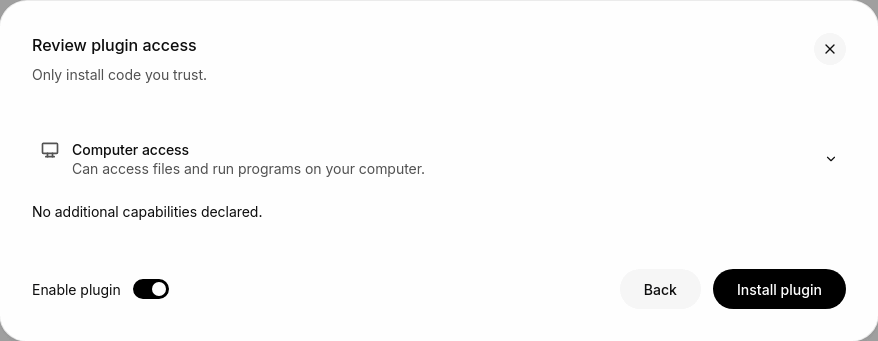
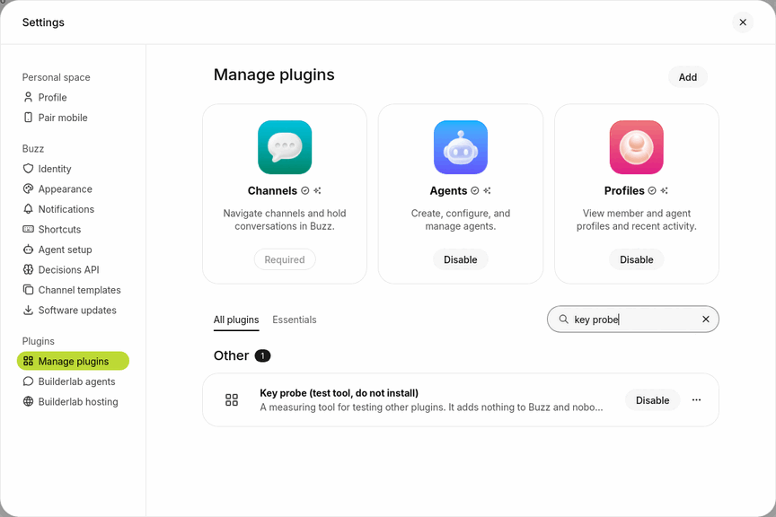

<picture>
  <source media="(prefers-color-scheme: dark)" srcset="../../assets/headers/key-probe-dark.svg">
  <source media="(prefers-color-scheme: light)" srcset="../../assets/headers/key-probe-light.svg">
  
</picture>

## What it is

A measuring tool, not a feature. For every key it records the time from the `keydown` reaching the window to the next frame on screen. It is a plugin of its own so the vim plugin can be measured with Vim mode on, off, or replaced by a new version, with the same instrument each time.

- **Ctrl+Alt+Shift+D** copies what was recorded, as JSON, to the clipboard.
- **Ctrl+Alt+Shift+X** starts over.

It reads no page content, keeps at most 5,000 keys, and sends and writes nothing. The scripts in [`plugins/vim/test/real-app`](../vim/test/real-app) install it and read it. You do not need it to use any plugin.

## Platforms

| macOS | Linux | Windows |
| --- | --- | --- |
| should work, untested | **works, tested** | should work, untested |

- **Linux:** the real-app scripts in [`plugins/vim/test/real-app`](../vim/test/real-app) install and read it in the Buzz desktop app on Linux; the timings in the Vim and Beeper notes were taken with it. Sources: `plugins/vim/NOTES.md`, "Measuring the plugin"; `plugins/beeper/NOTES.md`, "Real desktop app".
- **macOS** and **Windows:** not run. The notes do not mention them.

## How to install

**Do not install it to use Buzz or any other plugin.** It adds nothing to Buzz; it is a test tool, which is why Buzz lists it as **Key probe (test tool, do not install)**. The scripts in [`plugins/vim/test/real-app`](../vim/test/real-app) install it themselves (`plugin.sh install-probe`) when they measure the vim plugin. To measure by hand, load the folder `plugins/key-probe` as you would any plugin ([`docs/install.md`](../../docs/install.md)), or add the repository `https://github.com/0xnfrith/buzz-plugins` and pick the plugin with that name. To remove it: Settings → Plugins → Manage plugins, find it, and choose **Delete** from the **⋯** menu on its row.

Step-by-step with screenshots

The screenshots are from the Buzz desktop app on Linux, in the light theme, in a new profile with nothing in it. macOS and Windows look a little different and are not shown. Steps 1 to 4 are the same for every plugin in this repository.

**1. Open Settings, then Plugins, then Manage plugins, and press Add.**

**2. Choose how to load it.** The Add a plugin window has a folder on the left (drop one in, or press **Browse**) and a Git or GitHub repository on the right. The repository is the easier way: there is nothing to download first.

**3. Type `https://github.com/0xnfrith/buzz-plugins` and press Find.** Leave Branch or tag empty. If you have cloned this repository, use **Browse** instead and choose the folder `plugins/key-probe`.

**4. Pick Key probe (test tool, do not install) and press Continue.** Buzz lists every plugin in the repository with its folder and id.

**5. Read the review.** The Key probe declares no commands and no network addresses, so the review lists nothing beyond what every plugin gets. Press **Install plugin** only if you are measuring key latency.

**6. It is installed and turned on.** Search Manage plugins for it: its row says what it is, and **Disable** on the row means it is on. Its card has a **⋯** menu with **Delete**, which removes it.

