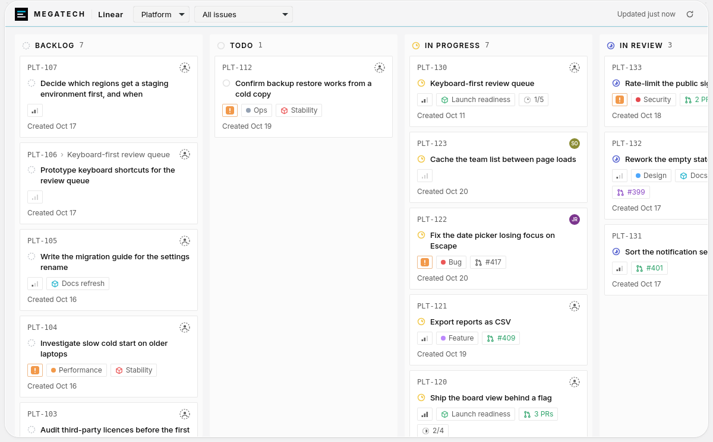
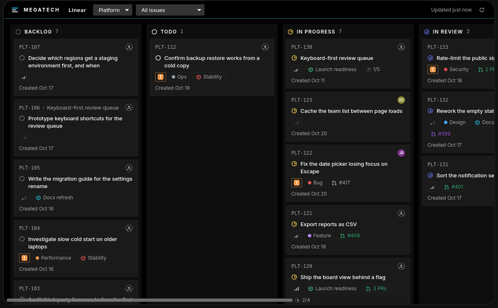
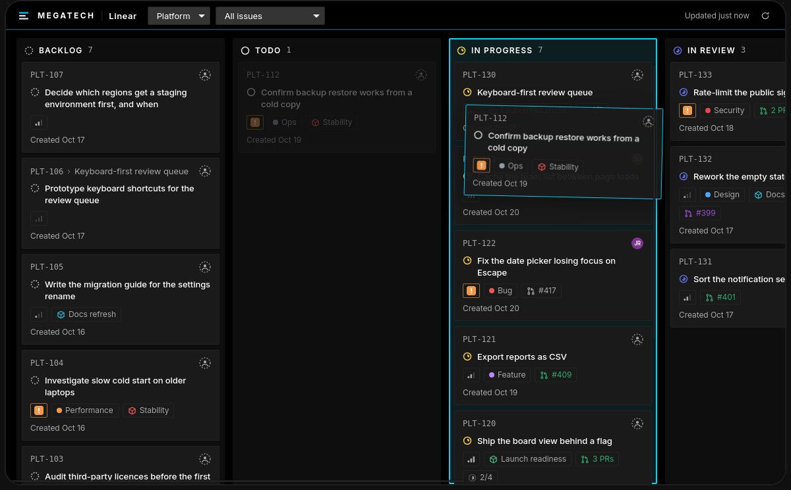
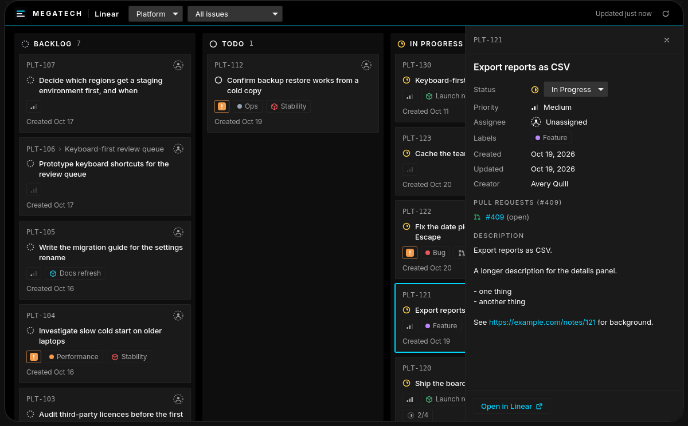
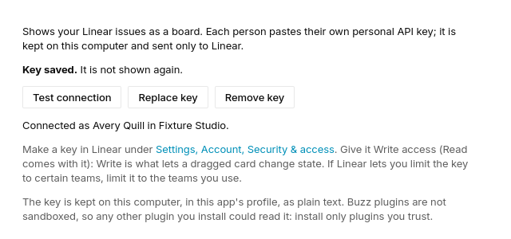
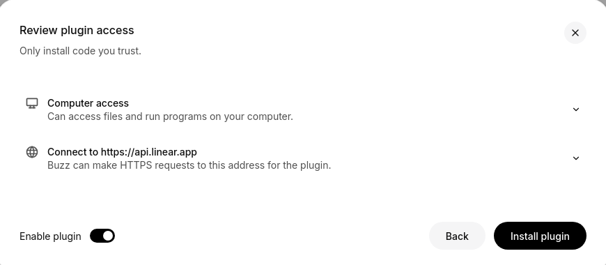

# Linear

Your Linear board inside Buzz: one column for each workflow state, in Linear's order, with cards that look like Linear's own. Drag a card to another column to change the issue's state; click a card for its details and an **Open in Linear** link.

## Getting started

1. Install it: Settings, Plugins, Manage plugins, Add, then load this folder or enter `https://github.com/0xnfrith/buzz-plugins` as the Git or GitHub repository and pick **Linear**. Review what it asks for (one network origin, `https://api.linear.app`) and install, then enable it.
2. In Linear make a personal API key: Settings, Account, Security & access, Personal API keys. It needs the **Write** scope (Write is what lets a dragged card change state; it includes reading). If Linear lets you limit the key to certain teams, limit it to the teams you use.
3. In Buzz open Settings, Plugins, **Linear**. Paste the key, press **Save key**. Linear is asked first: the card says who you are connected as, and a key Linear refuses is not saved (so a mistyped replacement never replaces a key that works).
4. Open **Linear** in the page navigation. Pick a team, and if you like a project or one of the team's saved views.
5. Drag a card to another column, or open it and use its **Status** menu. Cards can also be opened from the keyboard (Tab to a card, Enter).

The board asks Linear whether anything changed once a minute while the page is open and when the window comes back to the front, and reloads only if something did. **Refresh** reads everything again.

## Screenshots

Taken in the Buzz desktop app on Linux (WebKitGTK), with the plugin's test double standing in for Linear: the issues are invented.

| | |
| --- | --- |
|  |  |
| Light mode: columns, cards, MEGATECH header | Dark mode |
|  |  |
| Dragging a card: the target column lights up | Details, with **Open in Linear** |
|  |  |
| The settings card: the key is not shown again | The install review lists the one origin the plugin may reach. ("Computer access" is shown for every plugin: plugins are not sandboxed) |

## What to know before you paste a key

- The key is stored in the Buzz app's profile on this computer (the page's local storage, under this plugin's id), as plain text. Buzz has no credential store for plugins yet.
- **Any other plugin you install can read it.** Buzz plugins are not sandboxed: they run as trusted code inside the app. Install only plugins you trust, and give this key the least access it needs.
- The key is sent only to `https://api.linear.app`, through Buzz's own HTTP client, in the `Authorization` header. It is never shown again after saving (the card only says "Key saved"), never written to a log or an error message, and never part of this repository.
- **Remove key** in the card deletes it from the profile. Do that before you delete the plugin, and revoke the key in Linear too: I found no code in Buzz that clears a plugin's stored data when the plugin is deleted.
- Each person pastes their own key. Cards you move are moved as you, in Linear's history.

## What it does and does not do

- Shows one team at a time, optionally narrowed to a project or a saved view (the view's own filter, applied by Linear).
- Columns are the team's workflow states in Linear's order (triage, backlog, unstarted, started, completed, canceled, duplicate, then Linear's own position). Each column loads 50 issues; "50+" and **Show more** appear when there are more. Linear's API has no total count for a list, so this is the one place counts differ from Linear's own board.
- Cards in a column follow Linear's manual order (`sortOrder`) among the issues loaded so far, so **Show more** can slot older cards in among them; Done, Canceled and Duplicate show the most recently changed first.
- A card shows its first 6 labels, 10 attachments and 50 sub-issues; beyond that the label count, the PR chip and the sub-issue progress are short.
- Drag changes the state only. It does not reorder inside a column, and it does not create issues or change anything else.
- A card cannot be dragged into **Duplicate** (nor picked from the Status menu): Linear puts an issue there only when it is marked a duplicate of another, which the board cannot do, so the board says so and sends nothing.
- Initials stand in for avatars: the plugin does not load remote images.

---

Contributor notes: [`NOTES.md`](NOTES.md) (what works through the plugin API, how it was tested, what was not). Build with `pnpm install && pnpm build` (writes `plugin.js` next to `manifest.json`; the built file is committed because Buzz never runs a build). Unit tests: `pnpm test`. Tests in Buzz's web build: `test/run.sh <block/buzz-app checkout>`.
