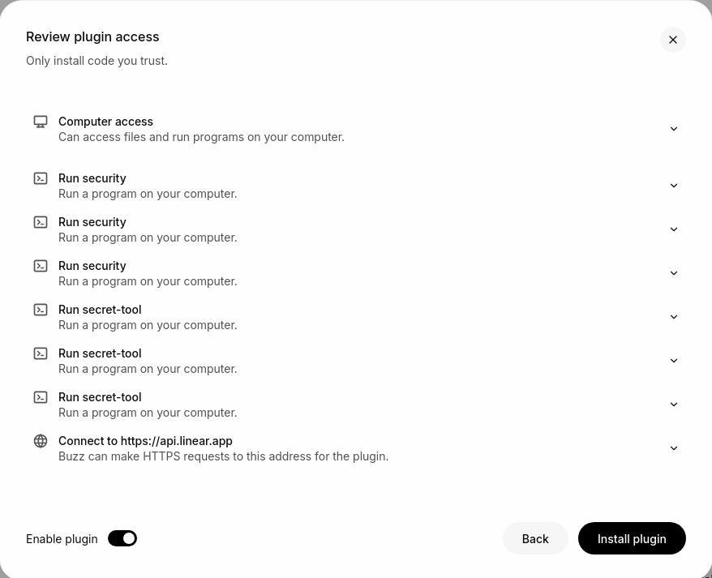
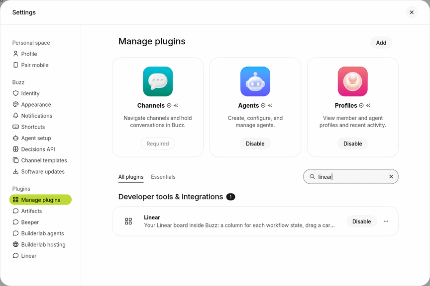
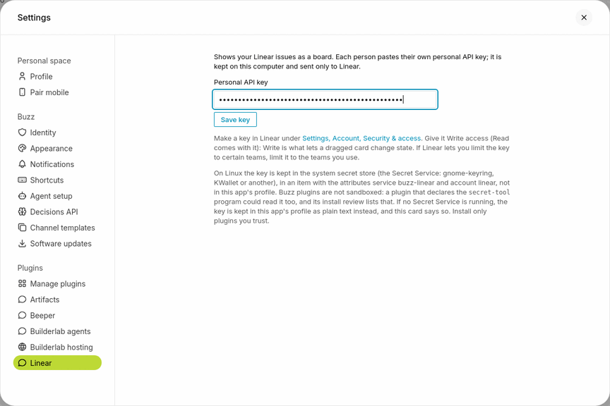
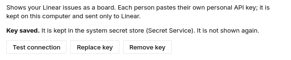

<picture>
  <source media="(prefers-color-scheme: dark)" srcset="../../assets/headers/linear-dark.svg">
  <source media="(prefers-color-scheme: light)" srcset="../../assets/headers/linear-light.svg">
  
</picture>

## What it is

Your Linear board inside Buzz: one column for each workflow state, in Linear's order, with cards that look like Linear's own. Drag a card to another column to change the issue's state; click a card for its details and an **Open in Linear** link. Each person pastes their own personal API key.

<picture>
  <source media="(prefers-color-scheme: dark)" srcset="screenshots/board-dark.png">
  
</picture>

## Platforms

| macOS | Linux | Windows |
| --- | --- | --- |
| should work, untested | **works, tested** | should work, untested |

- **Linux:** run by hand in the Buzz desktop app on Linux against a throwaway real Linear workspace, with the key kept in the real Secret Service. Source: `NOTES.md`, "What was verified".
- **macOS:** not run on a Mac. The Keychain path is tested only against a stand-in `security` program, and Mac WebKit (WKWebView) is unverified. Source: `NOTES.md`, "What was not verified".
- **Windows:** not run. Source: `NOTES.md`, "What was not verified". There is no key store the plugin can use there, so the key is kept in the app's profile as plain text, and the card says so.

## How to install

1. Install it: Settings, Plugins, Manage plugins, Add, then load this folder or enter `https://github.com/0xnfrith/buzz-plugins` as the Git or GitHub repository and pick **Linear**. Review what it asks for (one network origin, `https://api.linear.app`, and six commands for the key store: `security` three times and `secret-tool` three times) and install, then enable it.
2. In Linear make a personal API key: Settings, Account, Security & access, Personal API keys. It needs the **Write** scope (Write is what lets a dragged card change state; it includes reading). If Linear lets you limit the key to certain teams, limit it to the teams you use.
3. In Buzz open Settings, Plugins, **Linear**. Paste the key, press **Save key**. Linear is asked first: the card says who you are connected as. A key Linear refuses is not saved. If a key is already saved and Linear cannot be asked (it is unreachable, down or rate limiting), the saved key stays, nothing is saved, and the card says to try again, so a mistyped replacement never replaces a key that works. Only when there is no key yet is a key saved without being checked, and the card says so. On a Mac the key goes to your Keychain and on Linux to the system secret store (see below), and "saved" is said only once it has been read back from there.
4. Open **Linear** in the page navigation. Pick a team, and if you like a project or one of the team's saved views.
5. Drag a card to another column, or open it and use its **Status** menu. Cards can also be opened from the keyboard (Tab to a card, Enter).

The board asks Linear whether anything changed once a minute while the page is open and when the window comes back to the front, and reloads only if something did. **Refresh** reads everything again.

Step-by-step with screenshots

The screenshots are from the Buzz desktop app on Linux, in the light theme, in a new profile with nothing in it. macOS and Windows look a little different and are not shown. Steps 1 to 4 are the same for every plugin in this repository.

**1. Open Settings, then Plugins, then Manage plugins, and press Add.**

**2. Choose how to load it.** The Add a plugin window has a folder on the left (drop one in, or press **Browse**) and a Git or GitHub repository on the right. The repository is the easier way: there is nothing to download first.

**3. Type `https://github.com/0xnfrith/buzz-plugins` and press Find.** Leave Branch or tag empty. If you have cloned this repository, use **Browse** instead and choose the folder `plugins/linear`.

**4. Pick Linear and press Continue.** Buzz lists every plugin in the repository with its folder and id.

**5. Read the review and press Install plugin.** Linear asks for one network address, `https://api.linear.app`, and for six commands that keep your key in the system's secret store: `security` three times (the macOS Keychain) and `secret-tool` three times (the Linux secret store). A Mac only runs the first three and Linux the other three. Open a row to see the program and every argument. **Enable plugin** is on, so it is turned on as it is installed.

**6. It is installed and turned on.** Search Manage plugins for it: **Disable** on its row means it is on. It now has a page in the sidebar and a card in Settings.

**7. Paste your key.** Make a personal API key in Linear first (see step 2 above). Then open Settings, then **Linear**, paste it into **Personal API key** and press **Save key**. The box shows only dots.

Linear is asked first. When the key is accepted and the store has kept it, the card says so and offers **Test connection**, **Replace key** and **Remove key**. (Under this part the card also says who the key belongs to and in which workspace; that line is cropped out here.)

## What it looks like

| | |
| --- | --- |
|  |  |
| Dragging a card: the target column lights up | Details, with **Open in Linear** |
|  |  |
| The settings card: the key is not shown again | The install review, taken before the key stores were added |

<b>All screenshots, with the full captions</b>

### Screenshots

Taken in the Buzz desktop app on Linux (WebKitGTK), with the plugin's test double standing in for Linear: the issues are invented.

| | |
| --- | --- |
|  |  |
| Light mode: columns, cards, MEGATECH header | Dark mode |
|  |  |
| Dragging a card: the target column lights up | Details, with **Open in Linear** |
|  |  |
| The settings card: the key is not shown again (the plain-text fallback, shown on Linux with no Secret Service available to the plugin) | The install review, taken before the key stores were added: it listed the one origin the plugin may reach, and now also lists six commands (with every argument): three `security` for the Keychain, three `secret-tool` for the Secret Service. ("Computer access" is shown for every plugin: plugins are not sandboxed) |

## Details

<b>What to know before you paste a key</b>

### What to know before you paste a key

- **Where the key is kept.** On a **Mac**, in your **Keychain**, in an item named `buzz-linear` (account `linear`), through Apple's `security` program. On **Linux**, in the system secret store (the Secret Service: gnome-keyring, KWallet or another), in an item with the attributes `service buzz-linear` and `account linear`, through `secret-tool` (package `libsecret-tools`). The plugin hands the key to the program on its standard input, never as an argument, and reads it back to be sure it was kept; it reads it once, the first time the Linear page or its card is opened in a Buzz session (not when Buzz starts, so a locked keyring does not ask every time), and holds it in memory. Where there is no store the plugin can use (Windows, or Linux with no Secret Service running, or no `secret-tool`), the key is stored in the Buzz app's profile on this computer (the page's local storage, under this plugin's id) **as plain text**, and the card says which place holds it. Buzz has no credential store for plugins yet.
- **Who can read it.** A plain-text copy: **any other plugin you install can read it.** The Keychain or Secret Service copy: not from the profile, but a plugin that declares the same program (`security` or `secret-tool`) in its manifest could ask for it as well, and that plugin's install review lists the program. Buzz plugins are not sandboxed: they run as trusted code inside the app. Install only plugins you trust, and give this key the least access it needs.
- **If you had a key saved by an earlier version** (in the profile, as plain text), the first look moves it to the Keychain or the Secret Service: it is read back from there, and only then is the plain copy deleted. If the store will not take it, the plain copy stays and keeps working, the card says it is plain text, and the move is tried again at every look (or press **Move to Keychain** or **Move to secret store**). If the store and the profile both hold a key and they differ, which is newer depends on the system. **On Linux** the profile's is the newer one (a key reaches the profile there when the store could not be reached): it is moved over the store's, read back, and only then deleted; if the store will not take it, both are kept and the profile's is used. **On a Mac** a key never goes to the profile (a refused save keeps nothing), so a copy there is always an older one: the Keychain's key is used, whatever tool put it there (the Terminal command, for one), and the old plain copy is deleted. The update asks you to approve the new commands; the install review lists them.
- **If the store will not take a key from the plugin:**
  - **On a Mac** (for example if Buzz was started from a terminal, where `security` may ask that terminal instead of reading what the plugin sends it): nothing is kept anywhere, a key already saved stays as it was, and the card shows the one command to run in Terminal. It asks for the key itself (twice, showing nothing), so the key is not in the command. Press **Check Keychain** afterwards.
  - **On Linux** (no Secret Service running, a locked keyring nobody unlocked, `secret-tool` missing): the key is kept in the app's profile as plain text and the card says so, with the reason. It still works, and the plugin tries the store again at every start. If a key is already in the store, a replacement the store will not take is not kept at all (a plain copy beside it would only be shadowed by it): the saved key stays.
- The key is sent only to `https://api.linear.app`, through Buzz's own HTTP client, in the `Authorization` header. It is never shown again after saving (the card only says "Key saved"), never written to a log, an error message or a command line, and never part of this repository.
- **Remove key** in the card deletes the item from the Keychain or the Secret Service and any plain copy in the profile, and checks the store by reading it again (if it will not let go, the card says so and the key stays in use). Do that before you delete the plugin, and revoke the key in Linear too: I found no code in Buzz that clears a plugin's stored data when the plugin is deleted.
- Each person pastes their own key. Cards you move are moved as you, in Linear's history.

<b>What it does and does not do</b>

### What it does and does not do

- Shows one team at a time, optionally narrowed to a project or a saved view (the view's own filter, applied by Linear).
- Columns are the team's workflow states in Linear's order (triage, backlog, unstarted, started, completed, canceled, duplicate, then Linear's own position). Each column loads 50 issues; "50+" and **Show more** appear when there are more. Linear's API has no total count for a list, so this is the one place counts differ from Linear's own board.
- Cards in a column follow Linear's manual order (`sortOrder`) among the issues loaded so far, so **Show more** can slot older cards in among them; Done, Canceled and Duplicate show the most recently changed first.
- A card shows its first 6 labels, 10 attachments and 50 sub-issues; beyond that the label count, the PR chip and the sub-issue progress are short.
- Drag changes the state only. It does not reorder inside a column, and it does not create issues or change anything else.
- A card cannot be dragged into **Duplicate** (nor picked from the Status menu): Linear puts an issue there only when it is marked a duplicate of another, which the board cannot do. While a card is held the Duplicate column is greyed out and is not a drop target; if the card is dropped there anyway the board says so and sends nothing.
- Initials stand in for avatars: the plugin does not load remote images.

## For contributors

Contributor notes: [`NOTES.md`](NOTES.md) (what works through the plugin API, how it was tested, what was not). Build with `pnpm install && pnpm build` (writes `plugin.js` next to `manifest.json`; the built file is committed because Buzz never runs a build). Unit tests: `pnpm test` (with the type check, this is all CI runs: `.github/workflows/linear-tests.yml`). Tests in Buzz's web build: `test/run.sh <block/buzz-app checkout>`; CI does not run them, so run them by hand before a change is merged.
