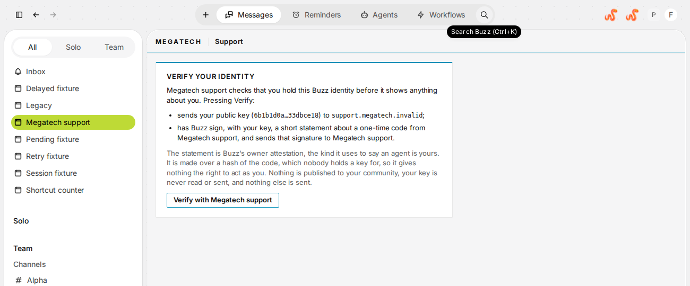
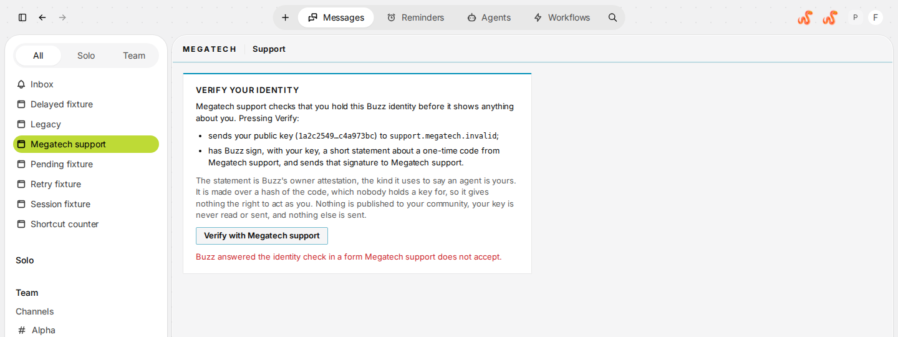
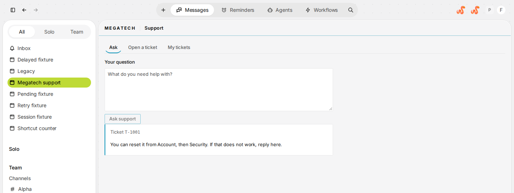
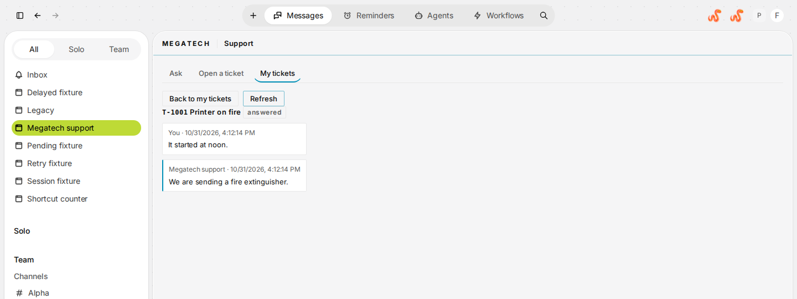
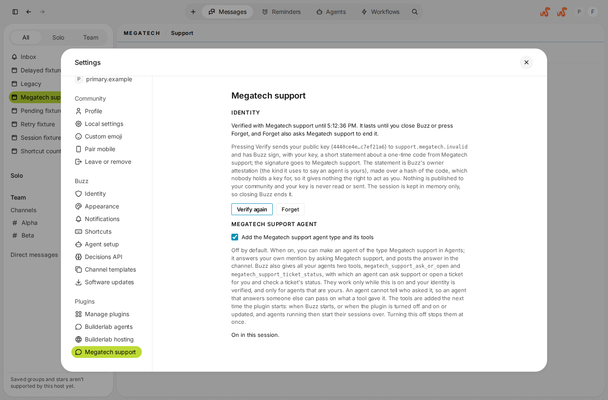
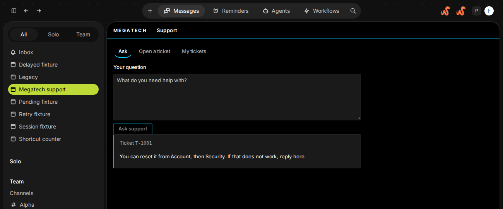
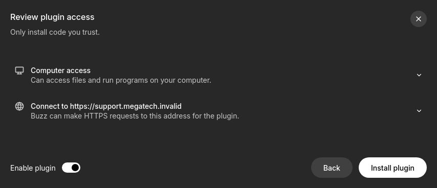

# Megatech support

Ask Megatech support, open a ticket and follow your tickets without leaving Buzz. It can also give your agents two tools, so an agent can ask support or open a ticket for you.

> [!IMPORTANT]
> **It works against a mock only, for now.** The support service it talks to does not exist yet, so the plugin points at a placeholder address, `https://support.megatech.invalid`, that never resolves. Until the service is hosted and the plugin is changed to its real address, installing it shows the page and the Settings card, and nothing more. The tests run it against a fake service.

## What it is

- **A page, Megatech support**, in the page navigation: **Ask** a question (you get an answer when support has one right away, and a ticket either way), **Open a ticket** with a subject and what happened, and **My tickets** to read each ticket's messages.
- **A Settings card** (Settings, Plugins, Megatech support) to verify your identity and to turn on the agent type and tools.
- **Off by default: a Megatech support agent type and two agent tools**, `megatech_support_ask_or_open` and `megatech_support_ticket_status`. Turn them on in the Settings card; they are added the next time the plugin starts (when Buzz starts, or when the plugin is turned off and on or updated; agents that are running then start their sessions over). Your own agents may then use the tools while your identity is verified. The agent type answers **your own** mention, in the channel it was mentioned in, with support's answer (cut at 4,000 characters, with the ticket named for the rest). A tool cannot tell who asked an agent, so an agent that answers someone else can pass on what a tool gave it.

## Screenshots

From Buzz's own web build, against the fake service in `test/fake-support`, with a made-up key (the install review under "How to install" is from the Buzz desktop app on Linux). Nothing here comes from a real service.

| The identity card, before anything is sent | The card when Buzz's answer is not accepted |
| --- | --- |
|  |  |
| **Ask: an answer and a ticket** | **My tickets, and one ticket's messages** |
|  |  |
| **The Settings card and the agent switch** | **Dark theme** |
|  |  |

## Platforms

| macOS | Linux | Windows |
| --- | --- | --- |
| should work, untested | **works against the mock, tested** | should work, untested |

- **Linux:** run in Buzz's own web build in a headless browser (the spec in `test/web`, which CI runs), and in the Buzz desktop app on Linux against the fake service (`test/real-app`). Source: `NOTES.md`, "What was verified".
- **macOS** and **Windows:** not run. The plugin uses only the host's HTTPS client and the host's identity attestation, which are the same on every system, but no one has tried.
- **Not run anywhere:** a real agent using the tools, and an agent of the Megatech support type; creating one publishes its profile on a relay, which the tests do not do. Source: `NOTES.md`, "What was not verified".

## How to install

1. Install it: Settings, Plugins, Manage plugins, Add, then load this folder or enter `https://github.com/0xnfrith/buzz-plugins` as the Git or GitHub repository and pick **Megatech support**. Review what it asks for: one network address, `https://support.megatech.invalid`, and nothing else (no commands, no files).
2. Open **Megatech support** in the page navigation and press **Verify with Megatech support**. The card says what is sent: your public key, and a signature made with your key over a hash of a one-time code from the service. Nothing is published to your community and your key is never read or sent.
3. Ask a question, or open a ticket.

The review lists one network address, `https://support.megatech.invalid`, the placeholder, and nothing else beyond what every plugin gets:

To give your agents the tools: Settings, Plugins, Megatech support, switch on **Add the Megatech support agent type and its tools**, then restart Buzz (turning the plugin off and on, or updating it, also starts it again). Turning the switch off stops the tools at once. The tools work only for agents that are yours: Buzz records an owner for each agent, and it has to be you, the person who verified.

Steps 1 to 4 of installing are the same for every plugin in this repository: see [`docs/install.md`](../../docs/install.md).

## What it sends, and what it keeps

- It talks to one address, through Buzz's own HTTPS client, and to nothing else.
- Your **public key** and one **signature** go to the service when you press Verify, and your questions and tickets go there when you send them. Buzz makes the signature: the plugin never sees your key.
- The session the service gives back is kept **in memory only**: closing Buzz, turning the plugin off or pressing **Forget** ends it, and the last two also ask the service to end it. The plugin keeps nothing else on disk but the on/off choice for the agent switch.
- Errors are shown in fixed words. The service's own wording is never shown.

## Security choice

Verifying uses a call Buzz's own agents use, not one made for plugins: Buzz's owner attestation (the signature that says "this key is an agent of mine"), made over a hash of a one-time code that nobody holds a key for, so it authorises nothing. Buzz could restrict that call, and then the plugin would stop verifying. `NOTES.md` explains the choice, why the attestation is inert and what the fallbacks are.

## Colours

Surfaces, text, borders and the hover step come from Buzz's own theme tokens, each with a fallback. The one colour the plugin adds is its cyan accent, named `--mts-cyan` on the plugin's own root. In the dark theme it is the bright `#00d4ff`. In the light theme the bright value would be too faint for text, lines and the focus ring (1.8:1 on white), so those use a **derived** darker value, `#0090b8` (3.7:1 on white, 3.4:1 on the light grey surface); the bright one is not used for anything that carries meaning.

## Developing

`pnpm install`, then `pnpm exec tsc`, `pnpm test` and `pnpm run build` (the built `plugin.js` is committed; CI checks that it is what the source builds to). The browser spec runs against a block/buzz-app checkout: `test/run.sh PATH_TO_CHECKOUT`. `NOTES.md` has the design and what was verified.
