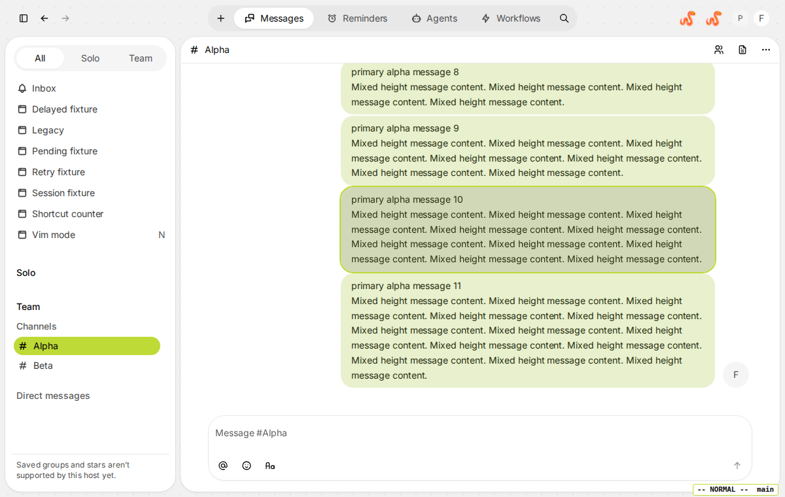
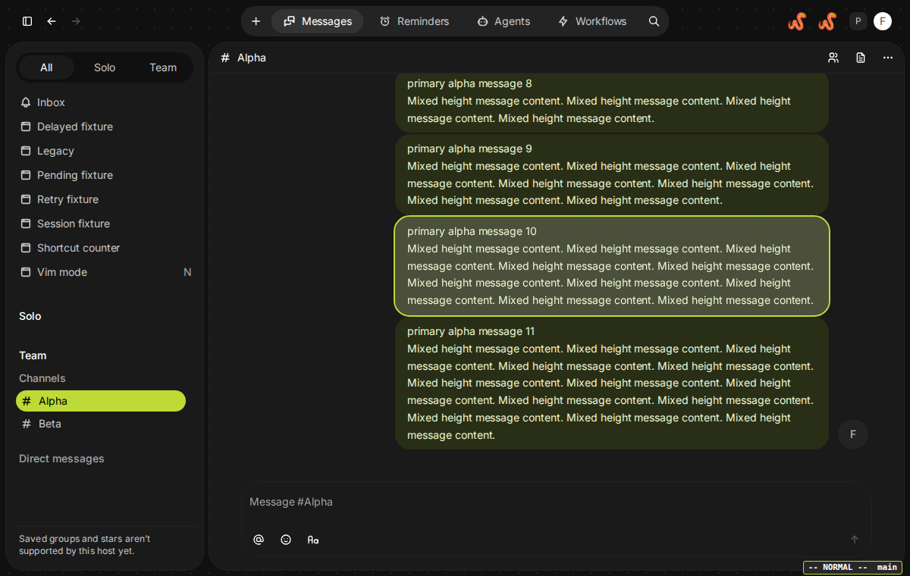
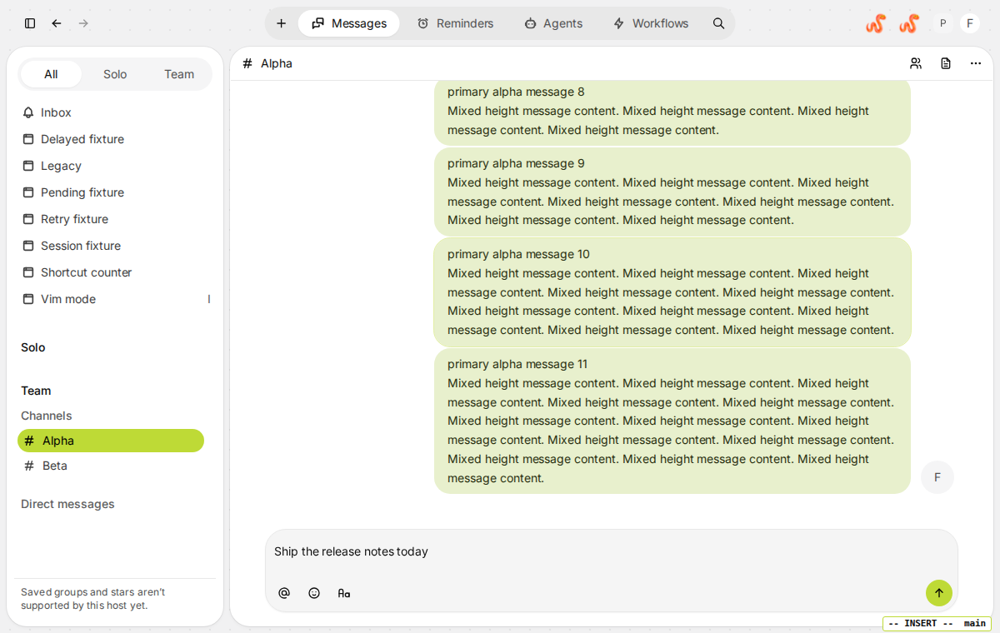
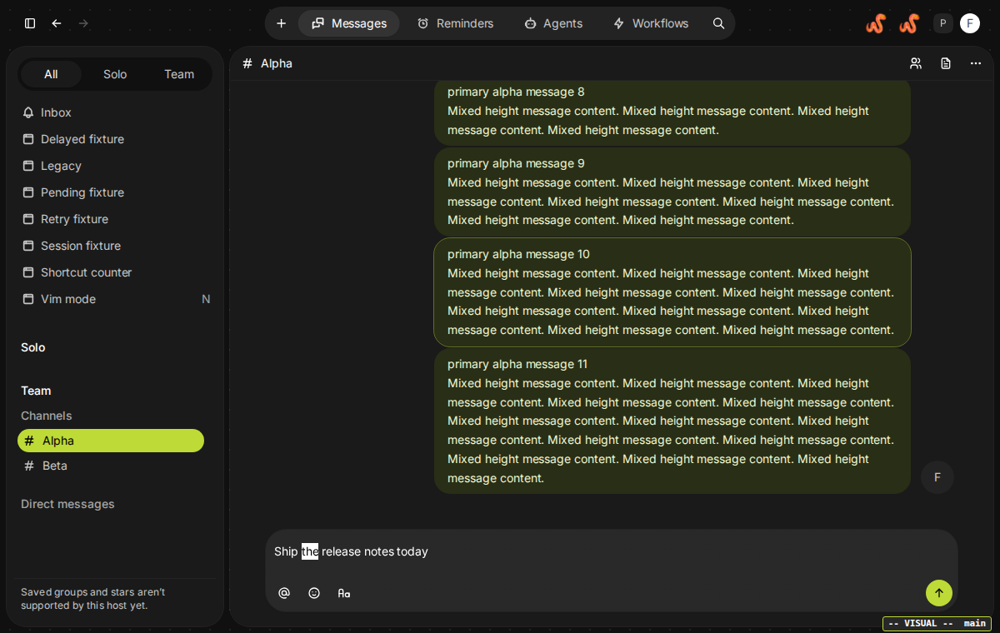
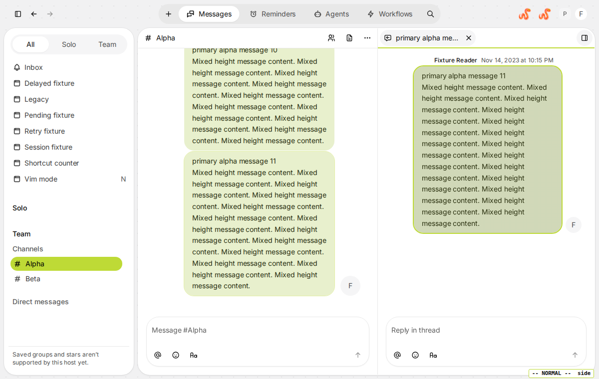
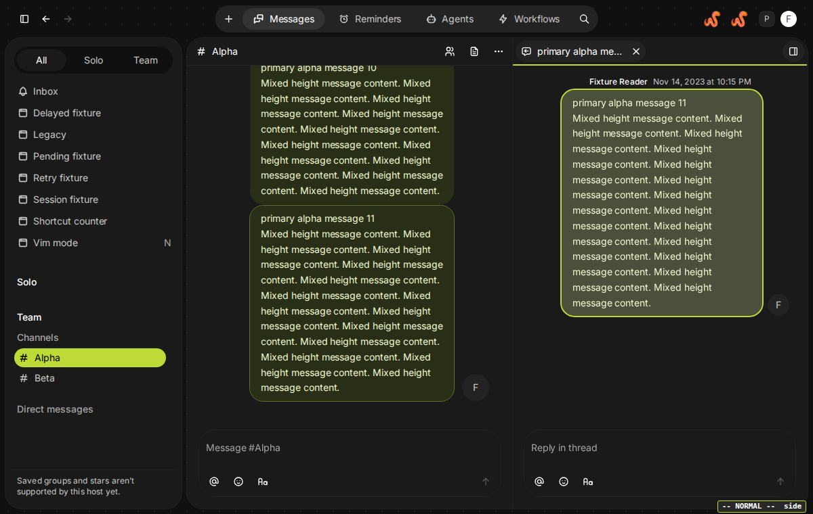
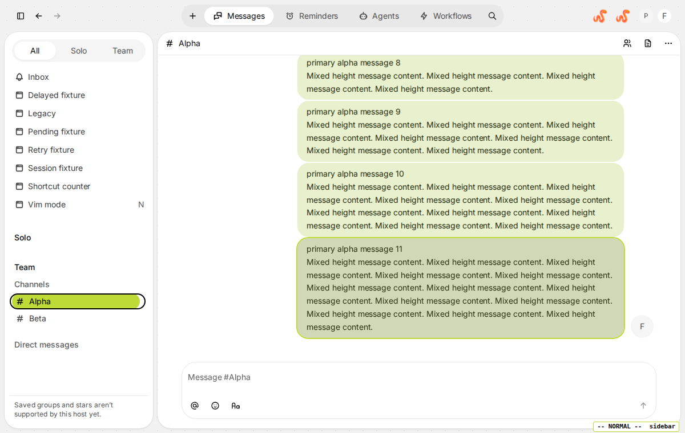
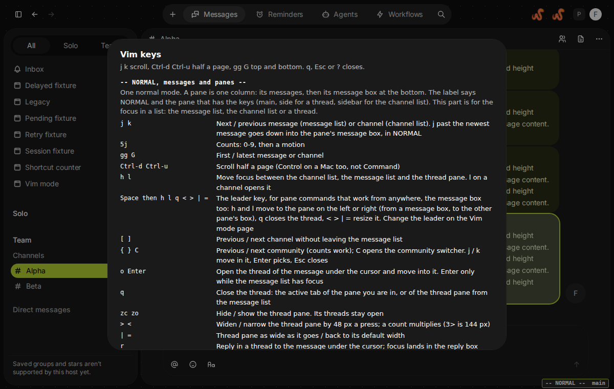

# Vim mode

Move through Buzz with vim keys: normal and insert modes, `j` and `k` through messages and channels, `h` and `l` between the channel list, the message list and a thread, `{` and `}` between communities, `gt` between pages, `r` and `m` on a message, and `o`, `q`, `zc`, `>` and `<` for threads. It began as a concept, built to learn what the plugin API reaches. `NOTES.md` has the findings.

## Getting started

1. In the desktop app open Settings, Plugins, Manage plugins, Load from folder, and choose this folder (the one that contains `manifest.json` and `plugin.js`). Install it, and enable **Vim mode** if it is not already on.
2. Open Messages and a channel with some history. A small `-- NORMAL --  main` label appears in the window's bottom-right corner (it says the mode and which pane has the keys), and the sidebar shows a **Vim mode** page with an `N` badge.
3. Work through the checklist below.
4. To stop at any time press Cmd+Shift+E (Ctrl+Shift+E elsewhere), or disable the plugin in Settings.

## Screenshots

Taken in Buzz's own browser test harness with its fixture data (`test/screenshots.spec.mjs`), in light and dark mode.

| Light | Dark |
| --- | --- |
|  |  |
| NORMAL: the cursor on a message. The bubble goes up a step in brightness (a step darker in light mode) and gets a thin accent outline | The same in dark mode |
|  |  |
| INSERT: the box has the keys, so it takes a much fainter lift and the message above gives up its own | The same in dark mode |
|  |  |
| NORMAL inside the message box | VISUAL: a motion grows the highlight |
|  |  |
| A thread beside the channel: the pane that has the keys has a 2 px accent line under its header | The same in dark mode |
|  |  |
| The channel list has the keys: a ring on the current channel | The key list, opened with `?` |

## Try this

| Step | Keys | Expected |
| --- | --- | --- |
| Click the message box, type `hjkl gg 5` | | The text appears. Label says `INSERT`. Plain keys never act while you type |
| Leave the message box | Esc, then `k` | Esc keeps focus in the box and the label says `NORMAL`; another Esc stays there, as in vim. `k` on the draft's first row goes up into the newest message; the leader key or `h` / `l` at the ends of the draft go one pane left or right. If a tooltip is showing, the first Esc closes it. With the page's switch for composer editing off, one Esc leaves the box |
| Place a cursor | `k` | The newest visible message's bubble goes up a step in brightness (a step darker in light mode) with a thin outline in your accent colour |
| Move the cursor | `k` `k` `j`, then `3k` | It moves one message at a time, three at once with a count |
| Jump | `g` `g`, then Shift+g | The oldest loaded message, then the newest |
| Scroll | Control+d, Control+u (Control, not Command, on a Mac) | Half a page down and up |
| Scroll a line | Control+e, Control+y (Control on a Mac too); `5` first for five lines | The view moves one line down or up and the cursor stays where it is. The cursor moves only when it would leave the view, onto the nearest message (or channel) that still shows. It scrolls the pane that has the keys: the message list, the thread pane, the channel list, a page such as Reminders, Agents, Workflows or Inbox (the page's list, when the focus is in the channel list), the Settings dialog (its list of sections or the open section). In the message box it works in NORMAL and leaves INSERT alone |
| Focus the channel list | `h` | A ring on the current channel. Label region says `sidebar` |
| Move in the list | `j` `k` | The ring moves between channels |
| Open a channel | `l` | The channel opens, focus goes to its message list, and you stay in normal mode (the message box is not focused) |
| Switch channel from the message list | `]` and `[` | Next and previous channel |
| Switch community | `}` and `{` (hold Shift), then `2{` | Next and previous community, in the switcher's order (Personal space first). Focus lands in the new community's channel list. A count jumps several |
| Pick a community | Shift+c, or `h` twice from a message | The community switcher opens on the current one. `j` and `k` move, Enter picks, Esc closes |
| Reply | Move the cursor with `k`, then `r` | The thread opens on that message and focus is in its reply box (`INSERT`) |
| Message menu | Move the cursor, then `m` | The message menu opens (copy, mark unread, ...). `j` and `k` move, Enter picks, Esc closes |
| Copy a message | Move the cursor, then `yy` (its link) or `yY` (its text), in the message list or a thread | Buzz's own Copy link and Copy message run and its toast says "Link copied" or "Message copied"; the link is the one Buzz makes (`buzz://message?...`, with `thread=` for a reply). The cursor and the focus stay where they were. A `y` that nothing follows within 1.5 s, or followed by another key, copies nothing. In the message box `y` is the box's own (`y` copies the highlight in VISUAL) |
| Pages | `g` then `t`, `g` then Shift+t | Next and previous page: Messages, Reminders, Agents, Workflows, Inbox, then the rest |
| Jump to a page | `gi` `gm` `ga` `gr` `gw` `gs` `gp`, from the message list, the channel list or a message box in NORMAL | Inbox, Messages, Agents, Reminders, Workflows, Settings, and Settings on Manage plugins (`gp`: plugins). Messages opens with the cursor in the message list, not in the message box. The app has Cmd+, (Ctrl+, elsewhere) for Settings too |
| Write | `i` | Focus goes to the message box. Label says `INSERT` |
| Search | `/` | Buzz's search opens (it presses Cmd+F for you) |
| Help | Shift+/ (`?`) | The key list opens over the page, centred on a dimmed backdrop, grouped NORMAL (messages and panes), NORMAL (the message box), INSERT, VISUAL. `j` `k` scroll it, Control+d and Control+u scroll half a page, `gg` and `G` go to the top and bottom, `q`, Esc or `?` close it and you are where you were |
| The switches | `g` then `v` | The Vim mode page opens (it holds the three switches and the same key list) |
| Open a thread | Move the cursor with `k`, then `o` (or Enter) | The thread opens beside the channel and focus is in its message list, in NORMAL, scrolled to the very bottom with the newest message marked (with threads placed over the channel, the same in the tab; the cursor goes back to the message when the tab stops showing: `q`, the tab's close button, Cmd+W or the channel's tab). `j` and `k` walk the replies, `i` writes a reply, `h` goes back to the channel. `l` and `zo` into a thread that is already open keep the message the pane had marked |
| Open and fold the replies to a reply | In a thread, `j` or `k` to a reply that has replies of its own (under it, a pill: "3 replies"), then `o` | The replies open under it, the pill is gone and the cursor stays on the reply. `o` again folds them: they are hidden and the count stands where the pill was, and `o` opens them again. Buzz opens a branch once and gives it no way to close, so the fold is the plugin's own: it hides the replies and draws the count, and Buzz still has the branch open. On a reply with no replies of its own, and on the first message of the thread, `o` does nothing. It works in a thread beside the channel and in one placed over it (told apart from the channel by its list, not by the pane). `Enter` and `zo` are unchanged |
| Close a thread | `q` | The thread closes and focus is back on the message list. It works from the thread and from the message list |
| Hide the thread pane | `zc`, then `zo` | `zc` hides the pane but keeps the thread open, `zo` shows it again |
| Resize the thread pane | Shift+`.` (`>`) and Shift+`,` (`<`), then `3>`, Shift+`\` (`\|`), `=` | Wider and narrower by 48 px a press, three presses at once with a count, as wide as it goes, and back to the default width |
| Leader | Space (Ctrl-w on a Mac), then `h`, `l`, `q`, `<`, `>`, `\|`, `=` | From anywhere, the message box too: `h` and `l` go to the pane on the left or right (from a message box, to the box of the pane beside it, or to the channel list), `q` closes the thread, the others resize it. Change the leader key on the Vim mode page |
| Down into the box | `j` on the newest message | The cursor drops into the message box, in NORMAL. `k` on the draft's first row goes back up to the newest message |
| Across the boxes | In a message box: `l` at the very end of the draft, `h` at the very start | The cursor goes one pane right or left, in NORMAL, by position: the thread's box is right of the channel's, which is right of the channel list. `h` from the thread's box goes to the channel's box, and `h` again to the channel list; `l` from the channel's box goes to the thread's box, and `l` from there stays (nothing lies to its right) |
| Active pane | Open a thread with `o`, then `h` and `l` | With a thread beside the channel, the pane that has the keys has a thin accent line under its header and a lifted, outlined message bubble; the other pane keeps its own marked message, with a faint outline only. Moving into a pane marks a message there at once. With the channel list focused neither pane has a line |
| Thread | Hover a message, click Reply, then Esc, `k`, `h`, `l`, `i` | Esc makes the reply box normal and does not close the thread. `k` goes up into the thread's newest message, `h` and `l` move between panes, `i` writes the reply. In a message list Esc does nothing: `q` closes the thread |
| Settings by keyboard | `gs` (or `gp`, which opens it on Manage plugins), then `j` `k`, `l` or Enter, `h`, Esc | Settings opens. `j` and `k` move through its sections, `l` or Enter opens one and goes into it, `h` comes back to the list, Esc closes it. Inside a section `j` and `k` move from one control to the next (in Manage plugins: the cards and their View and Disable or Enable buttons, the tabs, every plugin's buttons), so that from the cards `j` reaches the first plugin's Disable button with no Tab; with no control further on they scroll the section. Enter is Buzz's own on the control that has the focus (a button, a link and a switch all take it), and Control-e and Control-y still scroll. A text field (the search box) or a select is stepped over: Tab reaches it, and there `j` types and Tab leaves it again; an open menu keeps its own keys too, and every other dialog keeps the keys off |
| Turn off and on | Cmd+Shift+E twice | The label disappears and returns, and keys stop and resume |

**Inside the message box** (on by default; the Vim mode page has a switch to turn it off): Esc keeps focus and gives you `h j k l`, the words `w b e ge` and `W B E gE`, the line `0 ^ $`, the draft `gg G` (`3G` is line 3), finding with `f t F T` and `;` `,`, all with counts, plus `x`, `dd`, `d` with any of those, `u`, and `i` `a` `I` `A` to go back. Esc after a half-typed `d` or `f` only cancels it, and Esc in NORMAL stays in NORMAL. Control+e and Control+y scroll the pane's messages a line without touching the draft (not in INSERT, where the editor keeps them: on a Mac Control+e is end-of-line there); plain `e` is still end of word and `y` still yanks in visual mode.

**Mentions** (the chip `@name` that the `@` list inserts) count as one character in the draft: `h`, `l`, `w`, `b`, `x` step over it or take it as a whole, and the caret is put beside it, never inside, whichever way you come back into the box. A run of mentions at the **start** of a draft (`@a @b @c text`) is skipped as a whole on the way out: `h` from just right of the run, or from anywhere inside it, leaves the box like `h` at the start does, with no stop on the chips (`0` goes before the run). A run at the **end** is skipped the same way by `l` when a pane lies to the right (the thread's box, from the channel's); with none, `l` walks over it. A mention with text before it (at the start) or after it (at the end) keeps the one-character steps.

**Visual mode** in the message box: type a few lines (Shift+Enter makes a new line), press Esc, then `v` and the label says `VISUAL` with the character under the cursor highlighted. every motion above (`e`, `W`, `fx`, `3l`, `G` ...) stretches the highlight, `y` copies it to the clipboard, `d` or `x` deletes it, `c` deletes it and goes to insert mode, and Esc (or `v` again) leaves. `V` does the same by whole lines (`Vd` removes the lines and their newline). Switch between the two with `v` and `V`. There is no `p`: paste with Cmd+V.

## What to report

Which steps behaved differently, and for any that did nothing, whether the label changed. If the app has a developer console, any red errors that mention `megatech.vim-mode`.

## For developers

The source is TypeScript in `src/`, one module per concern (see "Source layout" in `NOTES.md`). The app loads only the built `plugin.js` next to the manifest and never runs a build, so the built file is committed with the source.

- **Build**: `pnpm install --frozen-lockfile`, then `pnpm build` (Node 22 or newer; `npm run build` works too). It type-checks `src/` and bundles it into `plugin.js`, unminified so that what you install is readable.
- **Browser tests**: `test/run.sh PATH_TO_BLOCK_BUZZ_APP_CHECKOUT` runs `test/vim.spec.mjs` against that checkout's browser harness. See `test/run.sh` for the one-time setup.
- **Key latency budget**: `test/budget.sh PATH_TO_BLOCK_BUZZ_APP_CHECKOUT`, below. A change to a key adds the key to it.
- **Measuring**: `test/perf.sh`, `test/real-app/` and "Measuring the plugin" in `NOTES.md`.
- **Screenshots**: `SPEC=screenshots.spec.mjs test/perf.sh PATH_TO_BLOCK_BUZZ_APP_CHECKOUT with 1` writes the pictures above into `SHOTS_DIR`.

## Key latency budget

Every key the plugin handles has to answer within a frame or two, in a channel with thousands of messages as well as in an empty one. `test/budget.spec.mjs` holds that for the keys it presses ("What is pressed", below, and the keys it does not press yet): it presses them on the surfaces listed there in headless Chromium, against the production web build of Buzz's own browser harness (the checkout `test/run.sh` also uses), and prints p50, p95, p99 and the maximum per surface and key.

**The budget.** The **gate** is p99 ≤ 50 ms: a row over it in all three attempts fails the test, and the GitHub job (`.github/workflows/vim-latency.yml`) fails the pull request. The **target** is p95 ≤ 16 ms, one frame at 60 Hz: it is reported, the rows over it are marked, and it does not fail anything.

**What is measured.** For every key press, the time from its `keydown` reaching the window (a capture listener, before any listener of the app or the plugin) to the **second frame painted after it**: two `requestAnimationFrame`s and then a message, which arrives once that frame is on screen. Both ends are `performance.now()`. It covers the handlers of the app and of the plugin, style, layout and paint, not the GPU. The second frame, because the plugin puts the work that has to wait for a scroll to lay out (the cursor moving after `Ctrl-e`, `gg` or `G`) behind two animation frames; the figures to the first frame are kept in the JSON. Chromium runs with `--disable-frame-rate-limit --disable-gpu-vsync`: otherwise every key waits up to a 60 Hz tick (16.7 ms) whatever the plugin does, and a p95 of 16 ms would be out of reach of an empty handler. `BUDGET_VSYNC=1` turns the tick back on.

**The data.** One channel with 3,000 messages in the store (the fixture's Markdown corpus: code, lists, quotes, mentions), 130 channels in the sidebar, a thread of 80 replies, a draft of 600 words and a draft with 30 mention chips. The harness serves only the newest page of a channel (a dozen messages) and holds the older ones until they are asked for, so the test first loads them all, as a reader who has scrolled back would have (the fixture's `olderPageDelayMs`, then "Load older messages" until it is gone). The app keeps at most 2,400 messages of a channel in its list, the newest (messages 600 to 2,999 here), so when the rows run the list holds **2,400 messages**, 458,639 px or some 630 screens high, of which the browser mounts a couple of dozen rows. Every row of the message list starts in the middle of it, where `k`, `j` and the scrolling keys have room. The suite fails if the list is not hundreds of screens high, or holds under a thousand messages.

**What is pressed.**

| Surface | Keys |
| --- | --- |
| Channel list, message list, thread's list | `j k 5j 5k Ctrl-e Ctrl-y gg G` (channel list also `gp`, which opens Settings on Manage plugins, with Esc closing it between presses; message list and thread also `h l`, between panes; message list also `o` and `Enter` on the newest message with its thread already open beside the channel, and `h` back from them, and `q` closing that thread beside the channel (the hand-back of a thread placed over the channel is not in a measured frame); message list also `yy` and `yY`, which copy the link and the text of the message under the cursor (the host's own Copy link button and Copy message menu item; the row counts the host's writes to the clipboard, because a yank leaves everything else as it was); thread also `o` on a reply that has a reply of its own, which folds the replies and opens them again) |
| A channel with a long thread (12 messages, one with 80 replies) | `o` on the message that has the thread, with the thread open already, and `h` back from it |
| Message box (600 words, and 30 mentions) | `w b 5w 5b 0 $ h l` |
| Reminders, Agents, Workflows pages | `Ctrl-e Ctrl-y`; `j k 5j 5k G gg` are control rows (a page has no message list: they find nothing to move) |
| Settings dialog | `j k 5j 5k l h`, `l` opening another section, `Ctrl-e Ctrl-y` |

**Not pressed yet.** The suite does not cover every key of the plugin. In the lists and panes: `Ctrl-d` `Ctrl-u`, `]` `[`, `}` `{`, `zc` `zo`, `>` `<` `|` `=`, `/`, `?` and the keys of its overlay, `i` `a` `A` `I`, `r`, `m`, `gt` `gT`, the page keys (`gi` `gm` `ga` `gr` `gw` `gs` `gv`), the leader. In the message box: `e E W B ge gE ^`, `j` `k`, `gg` `G`, `f t F T ; ,`, `x`, `d`, `dd`, `u`, `v` `V` and what they do in VISUAL. A key with no row has no budget; CONTRIBUTING.md asks that a change to a key adds it.

A key that does something only in one place is pressed there. Each key is warmed up (15 presses), then pressed 100 times, or fewer where the key walks one way along a short list (`j` `k` in the thread: 40; `w` `b` in the draft with mentions: 60; `q` and `o` on the long thread: 40, because each of their presses costs 100 ms or more and sets the page back after it, and they ran the job from about 20 to about 46 minutes at 100. The p99 of 40 presses is the largest, not the second largest; those rows are read against a control pressed as often, and their median is checked too). A row of two keys (`gg` and `G`, `Ctrl-e` and `Ctrl-y`) alternates them, so the cursor comes back to where it started; `j`, `k`, `w` and `b` walk one way from the same end in every attempt.

**Reading the table.** `script`, `style`, `layout` are the milliseconds of the page's main thread per press, from the engine's own counters: they tell whether a slow key is slow in JavaScript or in the browser's rendering. `moved` is the share of the presses after which anything on the page had changed (the focus, the cursor, a scroll position, the caret, the label). **A row that measures nothing is invalid, and fails the test.** If under 90% of a row's presses moved something, or under 90% of them had the focus on the row's surface (the list, the pane, the box, the dialog: `crosses` rows, whose keys move the focus between panes, are only checked for `moved`), the key was pressed where it does nothing or somewhere else, and its numbers say nothing about it: the table marks it INVALID. **Control rows** are references and never fail: a key nothing is bound to (the cost of an event and a frame), the app's own scrolling by the arrow keys, and, next to the plugin keys whose cost is mostly the app's, the same work done by the page itself (scroll a line, jump to the top, focus a channel row, open the next settings section). If the control costs 40 ms, the plugin's key cannot cost less.

**Noise.** The numbers are milliseconds, taken on a machine with other things to do, and p99 of 100 presses is their second largest (of fewer presses, the largest): one garbage collection or one stalled CI core can move it. The test therefore measures a row again (up to `BUDGET_ATTEMPTS`, three) and fails it only when its p99 is over the limit in every attempt, and collects the heap before each attempt. A real regression repeats; a stall does not. The table shows the p99 of every attempt. `BUDGET_ATTEMPTS=1` is the strict gate. If the gate still fails a pull request for no reason in the code, do not raise the limit: run the job again, then look at the attempts column and the control rows of the table.

**Known exceedances.** A key whose control is over 50 ms too is the app's. `test/budget.baseline.json` lists such rows, each with its control row and why. A listed row that is over 50 ms in an attempt is measured against its control in that same attempt, on the same machine, the control pressed as often as the key (100 presses, so the control's p99 is its second largest sample and not one stall that becomes room for the key). Two things must hold: p99 ≤ max(50, control p99 + 30), and p50 ≤ control p50 + 25. The median is what a stall in the control cannot hide: a plugin regression moves every press, a stall moves one. The rooms are added, not multiplied. On a machine where the control is under 20 ms the p99 limit stays at 50, so the file does not let a fast machine hide a regression; on a slow machine the limit moves with the machine. Any other row over 50 ms fails, and the table says "known" for the listed ones. There are no fixed limits in the file, and each entry is checked against the rows of its surface before anything is measured (a wrong name fails at once). Delete a line when the app (or the plugin) makes it unnecessary. `BUDGET_BASELINE=0` ignores the file.

**Run it.** Check out `block/buzz-app` at the commit in `BUZZ_APP_REF` of the workflow, install it (`pnpm install --frozen-lockfile`, `pnpm exec playwright install chromium`), then:

```
plugins/vim/test/budget.sh PATH_TO_BLOCK_BUZZ_APP_CHECKOUT
```

The table goes to the terminal, to `/tmp/vim-budget.md` and to `/tmp/vim-budget.json` (`BUDGET_OUT` changes the prefix). A full run takes 20 to 25 minutes on a two-core machine; `BUDGET_ONLY=thread,settings` runs some surfaces (`sidebar`, `list`, `thread`, `box-text`, `box-mentions`, `reminders`, `agents`, `workflows`, `settings`), `BUDGET_REPS` and `BUDGET_ATTEMPTS` shorten it. Close everything else, the Buzz app included: on a machine with 4 GB, the app alone was enough to double the numbers. Numbers from a small machine are for comparing two builds (below); the gate is the CI job's, on its own runner, and a local run can go red on rows that are green there. `BUDGET_PLUGIN=/path/plugin.js` measures another build of the plugin (the one on `main`, to compare a branch with it), and `BUDGET_TRACE=full` turns on the plugin's own trace, so each row also says how long each of the plugin's handlers ran per press and which DOM calls it made (those milliseconds are for finding where the time goes; the trace wraps DOM methods and distorts them).

**Adding a key.** A pull request that adds or changes a key adds it to the rows of every surface where it does something (`moves`, `boxRows` and the `surface(...)` blocks of `test/budget.spec.mjs`), in the same pull request; a new page or dialog gets a `surface(...)` of its own. If the new key is slow because of what the app does, add a control row that does the same work from the page, and put the key in `budget.baseline.json` only if the control is over 50 ms too.
